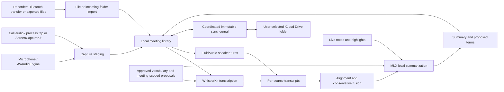

# Daybook architecture

Daybook is a native SwiftUI application for Apple silicon Macs running macOS 15 or later. Audio capture, model inference, meeting storage, and transcript synthesis execute in the application. Downloading a selected model is a separate operation from processing a recording.

## Layers

Photo storage, timeline placement, and merges live in DaybookCore; import metadata and export live in DaybookKit; Apple Vision and optional MLXVLM captions live in DaybookIntelligence. Both apps render the same photo records. See [Photos](photos.md) for the data flow and recovery behavior.

The package builds the shared logic for macOS 15 and iOS 26, so the Mac app and the iPhone app ([iphone.md](iphone.md)) stand on the same library. Each layer depends only on the ones above it in this list:

| Target | Platforms | Holds |
| --- | --- | --- |
| `DaybookCore` | macOS, iOS | Models, storage, the sync journal, fusion, alignment, echo DSP, and `ProcessingRequest` (stored on each meeting and merged across devices) |
| `DaybookDevices` | macOS, iOS | The device framework, Soundcore Work (Bluetooth transport with iOS state-restoration hooks, protocol, crypto, Opus), folder imports, and `DurationLabel`. Device UI and demos stay in the Mac app |
| `DaybookKit` | macOS, iOS | `LibraryController` (library state, every edit with its Version History, vocabulary, Trash, applying sync, recording ingest, processing requests), `LibrarySyncController`, search, places, `ProcessingStatus`, the `ProcessingEngine` seam, evidence and export, formatting, and the model catalog (the built-in ModelCatalog folder, selections, presets, acknowledgements; [models](models.md)). Re-exports Core and Devices |
| `DaybookIntelligence` | macOS (no AppKit) | Model engines (WhisperKit, FluidAudio Community-1 and Sortformer, MLX) in a registry, the model store, and `LocalIntelligenceRuntime` behind `MeetingInference`; `InferenceProcessingEngine`, the Mac's `ProcessingEngine` |
| `Daybook` | macOS | The app: `AppState` (capture, the processing queue, model downloads, devices' wiring, windows, and panels) holding a `LibraryController`, plus the SwiftUI and AppKit interface |

`ProcessingStatus` is derived per conversation from its data, its synced requests, and, on a Mac, that Mac's own queue; the list rows and the conversation page both read it, and the iPhone uses the same definition. The Mac's processing queue (`AppState.process`) stays in the app: it orders work, places new recordings, applies each recording's result as it arrives, moves recordings between conversations, and proposes vocabulary, calling the engine through the seam for transcripts, speakers, and summaries.

## Components and data flow



| Component | Responsibility | Implementation |
| --- | --- | --- |
| Library | Owns conversations, folders, templates, vocabulary, every edit and its history, Trash, sync application, ingest, and processing requests | [LibraryController](../Sources/DaybookKit/LibraryController.swift) |
| App state | Owns selection, capture, the processing queue, model selection, and UI state, holding the library | [AppState](../Sources/Daybook/App/AppState.swift) |
| Processing status | Derives Recorded, Requested, Processing, Done, or Couldn't finish for both apps | [ProcessingStatus](../Sources/DaybookKit/ProcessingStatus.swift), [ProcessingRequest](../Sources/DaybookCore/ProcessingRequest.swift) |
| Capture | Saves microphone and computer audio separately, records timing, and preserves interrupted captures | [RecordingController](../Sources/Daybook/Capture/RecordingController.swift), [CaptureRecovery](../Sources/Daybook/Capture/CaptureRecovery.swift) |
| Detection | Uses meeting-window evidence and per-process audio activity, with start/end debounce | [MeetingDetection](../Sources/Daybook/Capture/MeetingDetection.swift) |
| Core domain | Represents meetings, sources, transcript provenance, corrections, speakers, summaries, and highlights | [Models](../Sources/DaybookCore/Models.swift) |
| Local storage | Copies original bytes, deduplicates imports, validates paths, recovers metadata, and supports local trash | [MeetingStore](../Sources/DaybookCore/MeetingStore.swift) |
| Inference | Loads downloaded speech, speaker, and language models in process through their engines, behind the `ProcessingEngine` seam ([models](models.md)) | [LocalIntelligenceRuntime](../Sources/DaybookIntelligence/LocalIntelligenceRuntime.swift), [ModelEngine](../Sources/DaybookIntelligence/Engines/ModelEngine.swift), [ModelStore](../Sources/DaybookIntelligence/Store/ModelStore.swift), [InferenceProcessingEngine](../Sources/DaybookIntelligence/InferenceProcessingEngine.swift) |
| Transcript synthesis | Aligns source clocks and removes only sufficiently evidenced duplicate passages | [TranscriptFusion](../Sources/DaybookCore/TranscriptFusion.swift) |
| Vocabulary | Keeps proposed terms scoped to their source meeting until user approval | [GlossaryStore](../Sources/DaybookCore/GlossaryStore.swift) |

The core library depends on Foundation, making persistence and alignment tests independent of model downloads or microphone permissions. DaybookKit and DaybookDevices add Combine and, for Soundcore, CoreBluetooth and AVFoundation; none of the three import AppKit. The app uses actors for storage and inference. UI mutations belong to the main actor; the application owns sequencing across capture, import, editing, and inference operations.

## Capture and import

Microphone audio comes from `AVAudioEngine`. Call audio comes from a Core Audio process tap on the detected call app, or from `ScreenCaptureKit` (all Mac playback except Daybook) when no app is known or the tap fails. The app registers no video output and stores no screen frames. Separate source tracks share capture-session timing, with measured clock drift, so they can be combined without guessing their offsets from filenames or import dates. After a recording stops, the call's echo is removed from the microphone into a derived track that is transcribed instead of the untouched original. See [capture behavior and acceptance checks](capture.md).

Automatic recording is an explicit preference. Detection polls supported application/window patterns and audio activity, waits for sustained evidence before starting, and waits for evidence to disappear before ending. Browser process activity does not identify an individual browser tab. Localized or changed window titles, muted calls, sleep, and device changes need real-call validation; this is a heuristic, not an integration with each provider's meeting lifecycle API.

Recorder audio enters through the device layer ([devices.md](devices.md)): each device kind offers its own connection methods (direct, files, account) in order of preference. Soundcore Work connects directly over Bluetooth, with exported files as the fallback. Protocol, simulator, and native-codec tests do not establish physical firmware compatibility. The incoming-folder monitor waits for unchanged file metadata across scans before requesting import. The importer copies bytes, computes SHA-256 on the copied file, and deduplicates within the explicitly selected meeting. An advisory library-wide digest lookup is available for avoiding repeat incoming-folder deliveries. An unchanged size and modification time are a practical readiness signal, not a guarantee that an arbitrary external producer has closed a file.

Optional annotation files use `<audio basename>.highlights.json`; their current schema version is 1. Unversioned legacy sidecars are interpreted as version 1. The importer rejects unrelated JSON or unsupported schema versions with an explicit error. See the [sidecar example](soundcore.md#highlights-sidecar).

## Storage and recovery

The default root is `~/Library/Application Support/Daybook`:

```text
Daybook/
  Meetings/<meeting UUID>/
    meeting.json
    meeting.recovery.json
    Originals/<track UUID>.<original extension>
    Originals/<track UUID>.highlights-<SHA-256>.json
  Trash/<meeting UUID>/...
  Staging/<meeting UUID>/...
  Models/<engine>/<family>/<variant>/<revision>/   verified model installs (docs/models.md)
  Models/UserModels.json                           models the person added
  glossary.json
  glossary.recovery.json
```

The current meeting schema is version 1. Metadata writes use an atomic sibling-file replacement, retaining the previous validated snapshot: the file being replaced is swapped out (`RENAME_SWAP`) to become `meeting.recovery.json`, not encoded and written again. Files are compact JSON; earlier versions' pretty-printed files read the same. Parsing errors or invalid metadata can recover from that snapshot; the damaged file is retained. The store keeps each conversation as it last read or wrote it, keyed by the file's inode, size, and modification time, so a save reads nothing back unless something else changed the file, and a snapshot that changes nothing writes nothing.

Edits save in the background through one queue (`LibrarySaveQueue`): each conversation, the library settings, and the vocabulary have at most one save waiting, the latest snapshot wins, and it's written about half a second after an edit, so a burst of typing writes once. `flush()` writes everything waiting and returns only once nothing is left, including saves queued while it waited; the Mac flushes on quit and the iPhone when it leaves the foreground. A failed save is retried at the next flush with the current version, and ends when its conversation goes to the Trash or is deleted elsewhere (a save that finds its conversation trashed is moot). `flushDurably(_:)` reports failures only for the conversations a caller names (an import names its own), or for all without names. A future schema is rejected instead of being silently overwritten or rolled back. A corrupt meeting produces a warning while other meetings remain available. This provides process-restart recovery, not a substitute for an independent backup or a guarantee against storage-device failure.

Tracks, transcription runs, and correction history are append-only during normal metadata saves. An older queued notes snapshot cannot remove a recording imported while that snapshot was pending. Import also merges with the latest persisted meeting. The UI still owns reconciling concurrent changes to editable metadata such as notes, titles, and speaker names.

Audio filenames inside the library use generated identifiers. Relative paths cannot escape their meeting directory, including through symlinks to existing ancestors or nonexistent leaf files. Original audio is never moved out of its import location or overwritten. Highlight sidecars use content-addressed filenames, so a later sidecar cannot overwrite the earlier bytes.

Moving a meeting to local Trash moves its entire directory. Its original ID acts as a persistent tombstone that rejects queued stale saves. Local-only restoration moves it back; once a deletion has synced, recovery requires a new meeting UUID. This is application trash, not permanent erasure or the macOS Trash service.

Files use user-only permissions. This version does not add application-level encryption. Optional iCloud Drive synchronization exchanges the complete meeting library through immutable records and content-addressed originals. Local inference stays independent of sync; see [sync architecture](icloud-sync.md).

Concurrent sync merges keep transcript text, its clock alignment, and correction-review candidates together as one derived view. Notes and their paragraph anchors also travel together, including the alternate version retained in conflict history. During a process lifetime, unchanged local originals reuse an integrity check keyed by digest, size, modification time, and filesystem identity; a restart or file change triggers hashing again. A differing local original is preserved under `SyncConflicts` before verified remote bytes replace it.

## Transcript clocks and fusion

Raw transcript times are nonnegative seconds within their own audio file. Unified times are seconds on a shared meeting timeline and may be negative: a wearable can begin before the computer recording. Original times remain in `SegmentProvenance`, and playback should seek using those source times.

The first usable source in the meeting's transcription history defines the timeline origin. The latest model run for each source participates in synthesis, but prior runs remain stored. Attaching a longer source does not change the existing origin. A verified offset from capture or manual alignment is used directly. Otherwise, a stored audio alignment measured from the recordings' sound places the source (offset and clock drift; see [alignment and fusion](alignment.md)). Next, alignment searches for distinct shared phrases of at least four tokens and twenty normalized characters, and wall-clock start times are the last resort.

Automatic alignment requires at least three consistent anchors spanning ten seconds. A deterministic consensus fit estimates `meetingTime = sourceTime * rate + offset`, with rates restricted to 0.97–1.03. Candidate fits accept anchors within 1.5 seconds and must explain at least 60% of the selected anchors. Consensus work is bounded by sampling up to 120 anchors across the recording. Reports expose method, matched anchors, estimated rate/offset, and residual.

Placed sources are fused word by word. Speech that several recordings captured appears once, and its wording is decided by votes weighted by each source's role for that speech (call audio for remote participants, the microphone for the owner), signal-to-noise ratio, and recognition confidence. Short replies merge only with an unambiguous, closely timed counterpart. Speech only one recording heard is kept as is. A negation, a number, or a clause heard by one source survives unless at least two sources outvote it. Provenance lists every contributing source passage and which fused words each supported.

Tracks that cannot be aligned remain stored separately and are excluded from the unified transcript. A summary built from that transcript cannot claim to cover an unaligned recording. Manual timing can include it after review. A highlight with an unaligned source has no common-timeline timestamp; `Meeting.alignedTime(for:)` returns `nil`.

Alignment uses a single offset and clock rate per recording; it doesn't perform nonlinear time warping or global speaker identity matching. Speakers are attributed from source roles (the call's remote participants, the microphone's dominant local voice as the owner) and from speech that recordings share. `Meeting.fusionSummary` records each source's alignment method, offset, drift, confidence, and word contributions.

`Meeting.applyFusion` preserves user corrections when provenance identities survive a source preference change. New transcription runs use conservative same-source text/time correspondence to transfer corrections. Ambiguous mappings become review items with their original text retained. The user can apply a saved correction to a chosen passage or keep it only in history.

## Notes, synthesis, and learning

The floating notes panel shares the meeting's notes with the main library. New note paragraphs receive monotonic capture timestamps; pre/post-recording paragraphs stay untimed and later wording changes retain their first anchor. Timed notes are distinct timeline entries, never falsely attributed as spoken words. Highlights collect nearby recorded context (30 seconds before/60 seconds after by default), retain source time when unaligned, and direct additional detail in synthesis. Notes, mapped highlights, the unified transcript, the selected template, and allowed glossary terms form synthesis input. Local model output selects a meeting kind when requested and produces structured sections/actions. See [the model runtime](model-runtime.md) for model versions, offline loading, context budgeting, and validation.

Processing requests freeze selected models (with the exact revisions they resolve to), speaker effort, expected count, matching thresholds, and mode. `Process` handles new sources; `Refresh summary` needs only the language model; speaker relabeling reuses stored ASR words; full retranscription creates another source run. Older runs without words can be relabeled at passage granularity, with a visible notice. Source runs and summaries record the settings used and exactly which model made them: family, variant, revision, and engine version. Failed speaker-only refreshes leave the prior successful run active.

Named speakers are editable labels on anonymous clusters. Reusable Community-1 embeddings can match sources and reruns within the same meeting using a configurable cosine threshold and runner-up margin. Distinct embedding backbones are never compared; ambiguous matches remain separate. Sortformer does not provide reusable embeddings. There is no automatic identity enrollment across meetings. Learning currently means preserving corrections, summary revisions, and vocabulary approval; it does not change model weights. Proposed vocabulary remains scoped to its originating meeting. Only explicitly approved terms are eligible for other conversations.

## Verification boundary

[Core tests](../Tests/DaybookCoreTests) exercise persistence recovery, schema safety, path validation, original-byte preservation, duplicate imports, concurrent stale snapshots, reversible trash, glossary isolation, manual and inferred timing, clock drift, repeated phrases, ambiguous passages, and correction provenance. They use temporary libraries and synthetic text/audio bytes, without downloading models.

[Application tests](../Tests/DaybookTests), an opt-in real-model smoke test, and manual hardware acceptance cover different layers. Passing unit tests does not establish transcription accuracy, speaker accuracy, Soundcore firmware compatibility, or reliable call detection on every meeting app. Those require representative audio and real-device recordings.
