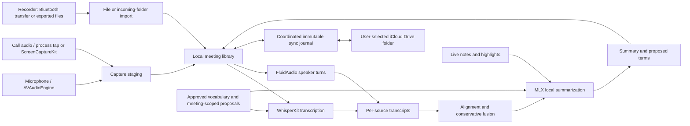

# Daybook architecture

Daybook is a native SwiftUI application for Apple silicon Macs running macOS 15 or later. Audio capture, model inference, meeting storage, and transcript synthesis execute in the application. Downloading a selected model is a separate operation from processing a recording.

## Layers

Photo storage, timeline placement, and merges live in DaybookCore; import metadata and export live in DaybookKit; Apple Vision and optional MLXVLM captions live in DaybookIntelligence. Both apps render the same photo records. See [Photos](photos.md) for the data flow and recovery behavior.

The package builds the shared logic for macOS 15 and iOS 26, so the Mac app and the iPhone app ([iphone.md](iphone.md)) stand on the same library. Each layer depends only on the ones above it in this list:

| Target | Platforms | Holds |
| --- | --- | --- |
| `DaybookCore` | macOS, iOS | Models, storage, the sync journal, fusion, alignment, echo DSP, and `ProcessingRequest` (stored on each meeting and merged across devices) |
| `DaybookDevices` | macOS, iOS | The device framework, Soundcore Work (Bluetooth transport with iOS state-restoration hooks, protocol, crypto, Opus), folder imports, and `DurationLabel`. Device UI and demos stay in the Mac app |
| `DaybookKit` | macOS, iOS | `LibraryController` (library state, every edit with its Version History, vocabulary, Trash, applying sync, recording ingest, processing requests), `LibrarySyncController`, search, places, `ProcessingStatus`, the `ProcessingEngine` seam, evidence and export, the transcript reading both apps draw (`TranscriptLayout`: turns, bookmark marks, and the playhead index, worked out once per version of a conversation; `PlaybackTarget`), formatting, and the model catalog (the built-in ModelCatalog folder, selections, presets, acknowledgements; [models](models.md)). Re-exports Core and Devices |
| `DaybookIntelligence` | macOS, iOS (no AppKit; on iOS without WhisperKit and MLXVLM) | Model engines (WhisperKit, Parakeet, FluidAudio Community-1, Nemotron 3, and Sortformer, MLX) in a registry, and `LocalIntelligenceRuntime` behind `MeetingInference`; `InferenceProcessingEngine`, the `ProcessingEngine` the Mac's queue and the iPhone's own recordings (`PhoneProcessor`) run; `LocalSummarizer` |
| `Daybook` | macOS | The app: `AppState` (capture, the processing queue, model downloads, devices' wiring, windows, and panels) holding a `LibraryController`, plus the SwiftUI and AppKit interface |

`ProcessingStatus` is derived per conversation from its data, its synced requests, and the device's own queue (a Mac's, or the iPhone's for its own recordings); the list rows and the conversation page both read it, and the iPhone uses the same definition. Which requests a device that processes its own recordings carries out, under the same claims, is `OnDeviceProcessing` ([iPhone](iphone.md#processing-on-this-iphone)). The Mac's processing queue (`AppState.process`) stays in the app: it orders work, places new recordings, applies each recording's result as it arrives, moves recordings between conversations, and proposes vocabulary, calling the engine through the seam for transcripts, speakers, and summaries.

## Components and data flow



| Component | Responsibility | Implementation |
| --- | --- | --- |
| Library | Owns conversations, folders, templates, vocabulary, every edit and its history, Trash, sync application, ingest, and processing requests | [LibraryController](../Sources/DaybookKit/LibraryController.swift) |
| App state | Owns selection, capture, the processing queue, model selection, and UI state, holding the library | [AppState](../Sources/Daybook/App/AppState.swift) |
| Processing status | Derives Recorded, Requested, Processing, Done, Waiting for another device's recording, or Couldn't finish for both apps | [ProcessingStatus](../Sources/DaybookKit/ProcessingStatus.swift), [ProcessingRequest](../Sources/DaybookCore/ProcessingRequest.swift) |
| Capture | Saves microphone and computer audio separately, records timing, and preserves interrupted captures | [RecordingController](../Sources/Daybook/Capture/RecordingController.swift), [CaptureRecovery](../Sources/Daybook/Capture/CaptureRecovery.swift) |
| Detection | Uses meeting-window evidence and per-process audio activity, with start/end debounce | [MeetingDetection](../Sources/Daybook/Capture/MeetingDetection.swift) |
| Core domain | Represents meetings, sources, transcript provenance, corrections, speakers, summaries, and highlights | [Models](../Sources/DaybookCore/Models.swift) |
| Local storage | Copies original bytes, deduplicates imports, validates paths, recovers metadata, and supports local trash | [MeetingStore](../Sources/DaybookCore/MeetingStore.swift) |
| Inference | Loads downloaded speech, speaker, and language models in process through their engines, behind the `ProcessingEngine` seam ([models](models.md)) | [LocalIntelligenceRuntime](../Sources/DaybookIntelligence/LocalIntelligenceRuntime.swift), [ModelEngine](../Sources/DaybookIntelligence/Engines/ModelEngine.swift), [ModelStore](../Sources/DaybookIntelligence/Store/ModelStore.swift), [InferenceProcessingEngine](../Sources/DaybookIntelligence/InferenceProcessingEngine.swift) |
| Transcript synthesis | Aligns source clocks and removes only sufficiently evidenced duplicate passages | [TranscriptFusion](../Sources/DaybookCore/TranscriptFusion.swift) |
| Vocabulary | Keeps proposed terms scoped to their source meeting until user approval | [GlossaryStore](../Sources/DaybookCore/GlossaryStore.swift) |

The core library depends on Foundation, making persistence and alignment tests independent of model downloads or microphone permissions. DaybookKit and DaybookDevices add Combine and, for Soundcore, CoreBluetooth and AVFoundation; none of the three import AppKit. The app uses actors for storage and inference. UI mutations belong to the main actor; the application owns sequencing across capture, import, editing, and inference operations.

## Capture and import

Microphone audio comes from `AVAudioEngine`. Call audio comes from a Core Audio process tap on the detected call app, or from `ScreenCaptureKit` (all Mac playback except Daybook) when no app is known or the tap fails. The app registers no video output and stores no screen frames. Separate source tracks share capture-session timing, with measured clock drift, so they can be combined without guessing their offsets from filenames or import dates. After a recording stops, the call's echo is removed from the microphone into a derived track that is transcribed instead of the untouched original. See [capture behavior and acceptance checks](capture.md).

Automatic recording is an explicit preference. Detection polls supported application/window patterns and audio activity, waits for sustained evidence before starting, and waits for evidence to disappear before ending. Browser process activity does not identify an individual browser tab. Localized or changed window titles, muted calls, sleep, and device changes need real-call validation; this is a heuristic, not an integration with each provider's meeting lifecycle API.

Recorder audio enters through the device layer ([devices.md](devices.md)): each device kind offers its own connection methods (direct, files, account) in order of preference. Soundcore Work connects directly over Bluetooth, with exported files as the fallback. Protocol, simulator, and native-codec tests do not establish physical firmware compatibility. The incoming-folder monitor waits for unchanged file metadata across scans before requesting import. The importer copies bytes, computes SHA-256 on the copied file, and deduplicates within the explicitly selected meeting. An advisory library-wide digest lookup is available for avoiding repeat incoming-folder deliveries: the new file is hashed off the main actor and matched against the digests already in memory, and only a conversation that claims the digest has its original hashed to confirm it. An unchanged size and modification time are a practical readiness signal, not a guarantee that an arbitrary external producer has closed a file.

Optional annotation files use `<audio basename>.highlights.json`; their current schema version is 1. Unversioned legacy sidecars are interpreted as version 1. The importer rejects unrelated JSON or unsupported schema versions with an explicit error. See the [sidecar example](soundcore.md#highlights-sidecar).

## Storage and recovery

The default root is `~/Library/Application Support/Daybook`:

```text
Daybook/
  Meetings/<meeting UUID>/
    meeting.json
    meeting.recovery.json
    Originals/<track UUID>.<original extension>
    Originals/<track UUID>.highlights-<SHA-256>.json
  Trash/<meeting UUID>/...
  Staging/<meeting UUID>/...
  Models/<engine>/<family>/<variant>/<revision>/   verified model installs (docs/models.md)
  Models/UserModels.json                           models the person added
  library.json                                     folders, templates, recorders, vocabulary (synced settings)
  library.recovery.json
  glossary.json
  glossary.recovery.json
```

The current meeting schema is version 1. Metadata writes use an atomic sibling-file replacement, retaining the previous validated snapshot: the file being replaced is swapped out (`RENAME_SWAP`) to become `meeting.recovery.json`, not encoded and written again. Files are compact JSON; earlier versions' pretty-printed files read the same. Parsing errors or invalid metadata can recover from that snapshot; the damaged file is retained. The store keeps each conversation as it last read or wrote it, keyed by the file's inode, size, and modification time, so a save reads nothing back unless something else changed the file, and a snapshot that changes nothing writes nothing.

Edits save in the background through one queue (`LibrarySaveQueue`): each conversation, the library settings, and the vocabulary have at most one save waiting, the latest snapshot wins, and it's written about half a second after an edit, so a burst of typing writes once. `flush()` writes everything waiting and returns only once nothing is left, including saves queued while it waited; the Mac flushes on quit and the iPhone when it leaves the foreground. A failed save is retried at the next flush with the current version, and ends when its conversation goes to the Trash or is deleted elsewhere (a save that finds its conversation trashed is moot). `flushDurably(_:)` reports failures only for the conversations a caller names (an import names its own), or for all without names. It is also the durability barrier before a recording's staging folder is deleted and before a sync pass is acknowledged: every file and folder the store wrote since the last barrier (metadata, recovery copies, imported originals, Trash moves) is fsynced, and the drive's cache is flushed once with `F_FULLFSYNC`. Ordinary saves are atomic but not flushed. `DurableFiles.write(_:to:)` is the same guarantee for one small file, such as a checkpoint. A future schema is rejected instead of being silently overwritten or rolled back. A corrupt meeting produces a warning while other meetings remain available. The library settings recover the same way: a damaged `library.json` is kept aside and its last saved copy used, an entry this version can't decode (a newer template kind) is left out rather than closing the library, and a file that can't be read or that a newer Daybook wrote opens read-only and is never overwritten. Opening the library fails only when its folder can't be opened; unreadable vocabulary or a conversation that can't be re-saved at launch is a notice. This provides process-restart recovery, not a substitute for an independent backup or a guarantee against storage-device failure.

Tracks, transcription runs, and correction history are append-only during normal metadata saves. An older queued notes snapshot cannot remove a recording imported while that snapshot was pending. Import also merges with the latest persisted meeting. The UI still owns reconciling concurrent changes to editable metadata such as notes, titles, and speaker names.

Audio filenames inside the library use generated identifiers. Relative paths cannot escape their meeting directory, including through symlinks to existing ancestors or nonexistent leaf files. Original audio is never moved out of its import location or overwritten. Highlight sidecars use content-addressed filenames, so a later sidecar cannot overwrite the earlier bytes.

Moving a meeting to local Trash moves its entire directory. Its original ID acts as a persistent tombstone that rejects queued stale saves. Local-only restoration moves it back; once a deletion has synced, recovery requires a new meeting UUID. This is application trash, not permanent erasure or the macOS Trash service.

Files use user-only permissions; the local library isn't encrypted by Daybook. Optional iCloud Drive synchronization exchanges the complete meeting library through immutable records and content-addressed originals, sealed end to end once the library is encrypted in iCloud ([encryption](icloud-sync.md#encryption)). Local inference stays independent of sync; see [sync architecture](icloud-sync.md).

Concurrent sync merges keep transcript text, its clock alignment, and correction-review candidates together as one derived view. Notes and their paragraph anchors also travel together, including the alternate version retained in conflict history. During a process lifetime, unchanged local originals reuse an integrity check keyed by digest, size, modification time, and filesystem identity; a restart or file change triggers hashing again. A differing local original is preserved under `SyncConflicts` before verified remote bytes replace it.

## Transcript clocks and fusion

Raw transcript times are nonnegative seconds within their own audio file. Unified times are seconds on a shared meeting timeline and may be negative: a wearable can begin before the computer recording. Original times remain in `SegmentProvenance`, and playback should seek using those source times.

The first usable source in the meeting's transcription history defines the timeline origin. The latest model run for each source participates in synthesis, but prior runs remain stored. Attaching a longer source does not change the existing origin. A verified offset from capture or manual alignment is used directly. Otherwise, a stored audio alignment measured from the recordings' sound places the source (offset and clock drift; see [alignment and fusion](alignment.md)). Next, alignment searches for distinct shared phrases of at least four tokens and twenty normalized characters, and wall-clock start times are the last resort.

Automatic alignment requires at least three consistent anchors spanning ten seconds. A deterministic consensus fit estimates `meetingTime = sourceTime * rate + offset`, with rates restricted to 0.97–1.03. Candidate fits accept anchors within 1.5 seconds and must explain at least 60% of the selected anchors. Consensus work is bounded by sampling up to 120 anchors across the recording. Reports expose method, matched anchors, estimated rate/offset, and residual.

Placed sources are fused word by word. Speech that several recordings captured appears once, and its wording is decided by votes weighted by each source's role for that speech (call audio for remote participants, the microphone for the owner), signal-to-noise ratio, and recognition confidence. Short replies merge only with an unambiguous, closely timed counterpart. Speech only one recording heard is kept as is. A negation, a number, or a clause heard by one source survives unless at least two sources outvote it. Provenance lists every contributing source passage and which fused words each supported.

Tracks that cannot be aligned remain stored separately and are excluded from the unified transcript. A summary built from that transcript cannot claim to cover an unaligned recording. Manual timing can include it after review. A highlight with an unaligned source has no common-timeline timestamp; `Meeting.alignedTime(for:)` returns `nil`.

Alignment uses a single offset and clock rate per recording; it doesn't perform nonlinear time warping. Speakers are attributed from source roles (the call's remote participants, the microphone's dominant local voice as the owner) and from speech that recordings share; across conversations, speaker profiles name them (see [Speakers and profiles](#speakers-and-profiles)). `Meeting.fusionSummary` records each source's alignment method, offset, drift, confidence, and word contributions.

`Meeting.applyFusion` preserves user corrections when provenance identities survive a source preference change. New transcription runs use conservative same-source text/time correspondence to transfer corrections. Ambiguous mappings become review items with their original text retained. The user can apply a saved correction to a chosen passage or keep it only in history.

## Background audio

A TV, a radio, or music playing in the room isn't the conversation, so it stays out of the transcript Daybook shows, the summary, and voice profiles. Nothing is deleted.

1. **Listening.** When a recording is transcribed, `InferenceProcessingEngine` asks `MeetingInference.classifySound`, which runs Apple's built-in sound classifier (SoundAnalysis, `SNClassifySoundRequest` `.version1`; part of macOS, nothing downloaded) over the recording in two-second windows every second ([SoundClassifier](../Sources/DaybookIntelligence/SoundClassifier.swift)). Each frame keeps three scores (speech; music, singing, and instruments; applause, cheering, and booing) and the level in dBFS, one byte each, on the track (`RecordingTrack.backgroundAudio`, `BackgroundAudioAnalysis`): about 14 KB an hour. It describes the audio, so it's measured once per recording and reused by later runs. If the classifier can't run, nothing is left out, without a notice.
2. **Deciding.** `BackgroundAudio.judge` ([BackgroundAudio](../Sources/DaybookCore/BackgroundAudio.swift)) marks a transcript run's passages, conservatively:
   - a passage the recognizer wrote as a sound ("[Music]", "(upbeat music)", lyrics between ♪, "[Applause]");
   - a passage at least 60% of whose frames have clear music or applause (≥ 0.5) and little speech (≤ 0.3): a song, a jingle, a soundtrack;
   - every passage of a broadcast voice: a diarized speaker with at least 4 s of speech, 60% of it with music about as strong as the voice (within 0.15), and at least 7 dB quieter than the loudest speaker who talks mostly without music. That's a presenter on a TV across the room with its music bed. The classifier alone can't tell the presenter from someone in the room talking over music, so the level (distance) has to agree, and someone talking at the conversation's level is never judged. The speaker's passages that are clear of background sound (80% of frames below 0.2) stay. Speakers the person named are never judged, and nothing is judged a broadcast without someone else talking mostly without music to compare with.

   A passage the person corrected is never judged either (`Meeting.backgroundVerdicts()`, through the passages fusion made it from): the correction says it's the conversation, and it stays in the transcript and in Version History.
3. **Leaving out.** `FusionInputs(meeting:)` passes the latest runs' verdicts to fusion, which leaves out a fused passage only when every recording that heard it judged it background; one source hearing it as conversation keeps it. The passages left out are kept, on the timeline, in `Meeting.backgroundPassages` (derived with the unified transcript and merged with it), and the transcript runs still hold every word. The summary reads the unified transcript, so it never sees them; a bookmark on an unplaced recording leaves them out of its context too.
4. **Voice profiles.** Before voice profiles are made, turns of a broadcast voice and turns at least half inside background passages are left out (`InferenceProcessingEngine.withoutBackground`), and a speaker judged music or broadcast gets no embedding, so `SpeakerMatcher` never matches anyone to a TV. The verdict for any run is `Meeting.backgroundVerdicts()` (passages and speaker labels), for any other profile evidence to skip. Speaker profiles never label or learn from a voice heard only in passages left out (`Meeting.backgroundOnlySpeakerIDs`); leaving background audio out again after it was included withdraws such a label and what it taught.
5. **Recovering.** Inspector › Audio says "Left out 2 min of music or TV" with **Include**, which sets `Meeting.includesBackgroundAudio` (synced, merged like a choice) and fuses again; **Leave Out** undoes it. There's no setting: the decision is per conversation and always reversible.
6. **Recordings transcribed earlier.** A recording transcribed before Daybook listened for background audio has no analysis (`Meeting.recordingsAwaitingBackgroundAudio`). The Mac listens to them on its own, after other work: 20 seconds after the last job, download, photo reading, voices given to speakers, sync, or recording ends, at low priority, newest conversation first, one recording at a time, stopping as soon as anything else starts ([AppState+BackgroundAudio](../Sources/Daybook/App/AppState+BackgroundAudio.swift)). `LibraryController.addBackgroundAudio` keeps the analysis on the track and fuses again only when that leaves something out; nothing is transcribed or summarized again, so the summary, the corrections, the names, and Version History stay as they were, and corrections carry over as in any fusion. Each recording is listened to once: one whose audio can't be read or classified isn't tried again until Daybook opens again. Speaker profiles reconcile when the passages left out change, so a voice found to be only a TV's loses its label.

The thresholds were set on synthetic recordings (speech from `say` in six voices, music from tones and noise bursts) and are recorded in [validation](validation.md#processing-quality-background-audio-notes-in-summaries-mac-first-multipoint-2026-10-29); synthetic rooms with reverberation, a TV's and a radio's loudspeakers, and a song with vocals confirmed them ([validation](validation.md#processing-follow-ups-earlier-recordings-notes-in-real-summaries-rooms-2026-10-30)). Limits: a presenter talking without music (a news anchor or radio host), a presenter less than about 7 dB quieter than the people, or a TV as loud as the people in the room, stays in; someone sitting farther from the microphone than the others (8 dB or more quieter) while music plays within about 9 dB of their voice is left out as a broadcast, and Include brings them back; the classifier has no TV or radio label, so broadcasts are recognized by their music, applause, and distance; level is measured per recording, so a recording made right next to the TV can't tell it's far away.

## Notes, synthesis, and learning

The floating notes panel shares the meeting's notes with the main library. New note paragraphs receive monotonic capture timestamps; pre/post-recording paragraphs stay untimed and later wording changes retain their first anchor. Timed notes are distinct timeline entries, never falsely attributed as spoken words. A summary reads the unified transcript with each timed note and bookmark placed in it at its time (`SummarySource`, built by `MeetingEvidence.summarySource`): passages within a minute before or 15 seconds after a note, and 30 seconds before or a minute after a bookmark, are marked "(near N1)" and carry more weight, and when a long conversation is compressed they reach the final pass word for word, each note's nearest passages first. The summary folds each note into the section it belongs to instead of listing notes after it ([templates](templates.md#notes-and-bookmarks)). A bookmark on a recording that isn't lined up keeps its source-local time and brings that recording's own passages. The selected template and allowed glossary terms complete the input. Local model output selects a meeting kind when requested and produces structured sections/actions. See [the model runtime](model-runtime.md) for model versions, offline loading, context budgeting, and validation.

A summary can instead run on a cloud model with the person's own Anthropic or OpenAI key ([cloud](cloud.md)): the same source, final prompt, schema, and commitments check in one pass, sending only the transcript text, the notes and bookmarks, the template, and the vocabulary. Transcription, speaker detection, voice profiles, and audio always stay on the device. The summary records the provider and model, its tokens, estimated cost, and the device that sent it.

Processing requests freeze selected models (with the exact revisions they resolve to), speaker effort, expected count, matching thresholds, and mode. `Process` handles new sources; `Refresh summary` needs only the language model; speaker relabeling reuses stored ASR words; full retranscription creates another source run. Older runs without words can be relabeled at passage granularity, with a visible notice. Source runs and summaries record the settings used and exactly which model made them: family, variant, revision, and engine version. Failed speaker-only refreshes leave the prior successful run active.

Model output is untrusted: a transcript or photo can carry instructions that steer a summary. Both apps render a summary's inline Markdown without links (`ModelText.inlineMarkdown` keeps a link's text and drops its target), and Markdown exports and Copy Summary escape what models wrote (`ModelText.escapingMarkdown` for the title, summary, actions, photo captions, and transcript), so an injected `[Open the deck](https://…)` can't become a disguised link and `` can't make a Markdown viewer fetch the summary. The person's own notes and bookmarks are exported as typed.

Beyond speaker profiles ([below](#speakers-and-profiles)), learning means preserving corrections, summary revisions, and vocabulary approval; it doesn't change model weights. Proposed vocabulary remains scoped to its originating meeting. Only explicitly approved terms are eligible for other conversations.

## Speakers and profiles

Speaker analysis leaves short gaps between turns (at a change of speaker, around a breath). A word in one belongs to the nearest turn when it's within a second (`TranscriptBuilder`); transcripts made before that are fixed when fused (`StrandedWords`: a passage of up to three words with no speaker takes the speaker of the passage of the same recording it sits against), and the Mac fuses such conversations again once at launch (`LibraryController.relabelStrandedWords`). Longer passages nobody was found for stay unknown.

Named speakers are editable labels on anonymous clusters. Within a conversation, voice embeddings match sources and reruns with a cosine threshold and runner-up margin (Settings › Models › Voice matching); distinct embedding spaces are never compared, and ambiguous matches remain separate. Community-1 makes embeddings itself; Nemotron 3 and Sortformer runs get them from the voice-profile model, Community-1, in the same space ([models](models.md), "Routing").

Across conversations, **speaker profiles** carry names ([SpeakerProfiles](../Sources/DaybookCore/SpeakerProfiles.swift), [SpeakerProfileReconciler](../Sources/DaybookCore/SpeakerProfileReconciler.swift), [SpeakerProfileBook](../Sources/DaybookCore/SpeakerProfileBook.swift)). Before them, a name given to a speaker stayed in its conversation: matching compared voices within one conversation only, and only when a recording was processed.

- **Profiles.** A profile is a name and voiceprints: the voice embeddings of speakers the person named or confirmed, and of speakers Daybook recognized with high confidence. Each voiceprint records where it came from (conversation, speaker, kind of recording, clean speech, the similarity it was learned at, dates), so it can be shown, removed, or undone with the label it came from. Profiles and voiceprints are library settings and sync with them ([sync](icloud-sync.md#speaker-profiles)); which speaker is which profile, and who decided, is the conversation's (`Meeting.speakerIdentities`).
- **Names teach.** Naming a speaker on any device (the rename is in Version History) teaches the profile with that name, created when the speaker has a voice to learn from. A profile's ID comes from the name that started it, so two devices naming the same person before they sync make one profile. Renaming the speaker again moves it to the new profile; a placeholder name ("Speaker 2") takes it out. Speakers named before profiles existed teach them the first time the Mac reconciles.
- **Profiles label.** The Mac reconciles the whole library whenever a name, a conversation, or a profile changes (`SpeakerProfileCoordinator`, two seconds after the last change, skipping what's being recorded or processed), and labels a conversation's speakers before writing its summary, so the summary has their names. Every speaker with an embedding is compared with the profiles in its embedding space; a fused speaker is compared through the recordings' speakers it stands for (the microphone's owner, a speaker matched or mapped to it).
  - Labelled (`recognized`: its name becomes the profile's) at the Voice Matching similarity (0.82 by default), beating every other profile by the Voice Matching margin (0.06), with at least 4 s of speech nobody talks over.
  - Otherwise suggested from 0.12 below that, the name unchanged.
  - Never over a name the person gave, or one Daybook didn't give (fusion's default "Me" for the owner excepted); never two voices of one recording as one profile, unless one is closer by the margin; never a profile the person said this speaker isn't, or one the person gave another voice in that recording.
  - A label stays while the voice is within 0.04 of the threshold and still the best by half the margin. When it no longer is (a voiceprint removed, the profile deleted), it comes off and the earlier name comes back.
  - With Match Voices Across Recordings off, names still teach profiles and labels stay; nothing new is labelled.
- **Adapting.** A recognized speaker teaches its profile (a `recognized` voiceprint) when it's at least 0.04 above the threshold and clear of other profiles by twice the margin; has 15 s of speech nobody talks over, and at least a tenth of its recording's speech (a background voice doesn't); is within 0.04 below the threshold of the person's own voiceprints; and isn't 0.97 alike to a voiceprint the profile has. A named voice less than 0.4 alike to the profile's named voiceprints keeps its name but isn't learned (a slip of the name, or a broken embedding).
- **Matching.** Per embedding space, a profile keeps a centroid per kind of recording (microphone, call audio, Soundcore Work, phone), so one voice through different microphones is recognized; a voice is as alike as its closest centroid. Voiceprints count by origin (named or confirmed 1, learned 0.5), by clean speech (up to 30 s), and by age (half again every 180 days before the profile's newest voiceprint, never below a quarter for the person's own), so the same profile scores the same on every device whenever it's compared.
- **Never drifting onto someone else.** Learned voiceprints never outweigh the person's own in a centroid, and can raise a voice's similarity at most 0.08 above what the person's own voiceprints give; every learned voiceprint had to be close to those when it was learned; a voice is never compared with what was learned from it; and a profile with none of the person's voiceprints in a space matches nothing there.
- **Bounded.** Per profile and space: 8 voiceprints the person chose and 16 learned. Beyond that, the ones that count least are retired, keeping one per kind of recording where possible; once full, a learned voiceprint older than all the learned ones isn't added. A retired or removed voiceprint leaves a deletion marker, so it's never learned again.
- **Undoing.** In the inspector (and the iPhone's Info › People), a label shows Recognized with Not <name>, and a suggestion Maybe <name> with Yes and No. Not (or renaming the speaker) takes the label off, puts the earlier name back, and the profile forgets what it learned from that speaker, on every device; a voice another speaker the person named that profile still stands for (the microphone's owner and its own speaker are one voice) stays. Yes makes the speaker the person's (`confirmed`, in Version History) and teaches the profile. Speaker Profiles (Settings › Models › Speakers on the Mac, Settings › Speaker Profiles on the iPhone) lists each profile's voiceprints with where they came from, removes one, forgets everything a profile learned on its own, renames a profile (labels follow, names the person gave stay), merges it into another, and deletes one (its labels come off).
- **Merging.** One person named two ways ("Vlad" here, "Vladimir" there) makes two profiles, and a rename to the other's name is refused, with Merge Into <name> offered instead (also in the profile's menu). Merging writes one record: the merged profile with `mergedInto` (`SpeakerProfileMerges`). Its voiceprints count for the kept profile from then on, its name finds the kept profile when it's given again, and the Mac moves its speakers' identities over as it reconciles, so labels take the kept profile's name; names the person gave stay. Nothing else is rewritten, so what another device does with the merged profile before the merge arrives (a name taught, a label given) follows it; two devices merging each profile into the other keep the later merge, the same on both; and a profile merged into one that's deleted is gone too ([sync](icloud-sync.md#speaker-profiles)). A merge isn't undone from the app.
- **Names in summaries.** A summary is written with the names speakers had then. When a speaker loses a name Daybook gave it (a placeholder, fusion's "Me" for the microphone's owner, or a label), however it happens (the person renames it, Yes or Not, a label given or taken off, a profile renamed or merged), the summary's mentions of that name, whole words only, become the new one (`Meeting.summaryFollowsRename`, [SummarySpeakerNames](../Sources/DaybookCore/SummarySpeakerNames.swift)): in place, so ticked next steps, photos, and IDs stay, with the summary it replaces in Version History (one entry, even when two Macs make the same change). Only while no other speaker of the conversation still has the old name. A name the person gave is theirs: renaming it again leaves the summary alone, and Summarize Again rewrites it.
- **Speakers without voices.** Speakers found without voice embeddings (Sortformer runs from before voice profiles, or a voice-profile model that couldn't run) can't be recognized. While the library has profiles and the Mac is idle, it gives them voices (`AppState.giveVoicesWhenIdle`, newest conversation first): Identify Speakers Again's voice step over each saved run's turns (`InferenceProcessingEngine.voices`), without finding the speakers again, so names, identities, the transcript, and the summary stay. Turns in background audio are left out and a broadcast voice gets none, as when voices are first made. Queued work stops it and it starts again when the queue is idle; it needs the voice-profile model on the Mac (nothing is downloaded for it) and the recording's audio there. A name given before its voice was known starts its profile once the voice arrives.

Limits: the thresholds come from the in-conversation defaults and synthetic tests, not real recordings (see [validation](validation.md), and `Daybook --speaker-report <library>` for a dry run over a copy of a real one); a run made with speaker detection off has no speakers to give voices to, so it still needs Identify Speakers Again; the iPhone shows labels, answers them, and edits profiles, and reconciles only a conversation it processes itself, before its summary (the Mac reconciles the rest when the change arrives).

## Verification boundary

[Core tests](../Tests/DaybookCoreTests) exercise persistence recovery, schema safety, path validation, original-byte preservation, duplicate imports, concurrent stale snapshots, reversible trash, glossary isolation, manual and inferred timing, clock drift, repeated phrases, ambiguous passages, and correction provenance. They use temporary libraries and synthetic text/audio bytes, without downloading models.

[Application tests](../Tests/DaybookTests), an opt-in real-model smoke test, and manual hardware acceptance cover different layers. Passing unit tests does not establish transcription accuracy, speaker accuracy, Soundcore firmware compatibility, or reliable call detection on every meeting app. Those require representative audio and real-device recordings.
