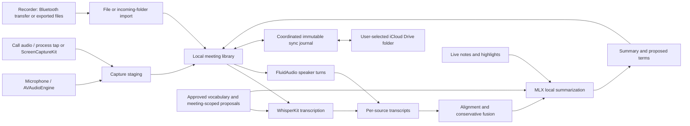

# Daybook architecture

Daybook is a native SwiftUI application for Apple silicon Macs running macOS 15 or later. Audio capture, model inference, meeting storage, and transcript synthesis execute in the application. Downloading a selected model is a separate operation from processing a recording.

## Layers

Photo storage, timeline placement, and merges live in DaybookCore; import metadata and export live in DaybookKit; Apple Vision and optional MLXVLM captions live in DaybookIntelligence. Both apps render the same photo records. See [Photos](photos.md) for the data flow and recovery behavior.

The package builds the shared logic for macOS 15 and iOS 26 (and `DaybookWatchLink` for watchOS 26 too), so the Mac app and the iPhone app ([iphone.md](iphone.md)) stand on the same library. It stays in Swift 5 language mode; DaybookCore, DaybookKit, DaybookCaptions, and DaybookDesign build with complete concurrency checking (`StrictConcurrency`), so a data race there is a warning (the rest turn it on as each reaches none), and their shared state is held in `Mutex` or `Atomic` (Synchronization) rather than a lock behind `@unchecked Sendable`. Each layer depends only on the ones above it in this list:

| Target | Platforms | Holds |
| --- | --- | --- |
| `DaybookCore` | macOS, iOS | Models, storage, the sync journal, fusion, alignment, echo DSP, and `ProcessingRequest` (stored on each meeting and merged across devices). What a Version History entry changed is read and written as a `RevisionField` (`.notes`, `.segment(UUID)`, `.speaker(String)`, …), stored as text ("segment:<UUID>"); Version History's `RevisionRestore` and `RevisionText` switch on it rather than split the text; `Meeting.renamedSpeakerIDs` and `correctedSegmentIDs` are the person's renames and corrections, and both apps' transcripts mark a corrected passage from `TranscriptLayout.correctedSegmentIDs`, worked out once per version of the conversation. Both apps' capture measures its input with `AudioLevelMeter` and says when the microphone isn't hearing by `HearingCheck`; an error whose words are Daybook's own sentence says so by conforming to `PlainSentenceError` |
| `DaybookWatchLink` | macOS, iOS, watchOS | What Daybook on iPhone and Daybook on Apple Watch say over WatchConnectivity (`WatchMessage`, `PhoneContext`, `WatchState`, `WatchSegment`), the iPhone's record of a watch's segments (`WatchSegmentLedger`), and the watch's rules for following the iPhone and journaling its segments. Foundation only: it's all the watch app links ([watch](watch.md)) |
| `DaybookDevices` | macOS, iOS | The device framework, Soundcore Work (Bluetooth transport with iOS state-restoration hooks, protocol, crypto, Opus), Apple Watch (`WatchConnection` over a `WatchTransport` the iPhone app supplies), folder imports, and `DurationLabel`. Device UI and demos stay in the Mac app |
| `DaybookKit` | macOS, iOS | `LibraryController` (library state, every edit with its Version History, vocabulary, Trash, applying sync, recording ingest, processing requests), `LibrarySyncController`, search, places, `ProcessingStatus`, the `ProcessingEngine` seam, evidence and export, the transcript reading both apps draw (`TranscriptLayout`: turns, bookmark marks, the playhead index, the passages the person corrected, and the unsure words that show, worked out once per version of a conversation; `PlaybackTarget`), the words and presentations for both apps (see "Shared words" below; a problem's words are `ProblemWords`), what Spotlight lists (`SpotlightPlan`), formatting, and the model catalog (the built-in ModelCatalog folder, selections, presets, acknowledgements; [models](models.md)). Re-exports Core and Devices |
| `DaybookIntelligence` | macOS, iOS (no AppKit; on iOS without WhisperKit and MLXVLM) | Model engines (WhisperKit, Parakeet, FluidAudio Community-1, Nemotron 3, and Sortformer, MLX) in a registry, and `LocalIntelligenceRuntime` behind `MeetingInference`; `InferenceProcessingEngine`, the `ProcessingEngine` the Mac's queue and the iPhone's own recordings (`PhoneProcessor`) run; `LocalSummarizer` |
| `DaybookDesign` | macOS, iOS (and the iPhone's widgets) | The design both apps draw: the tokens (`DaybookPalette`, type roles and density, spacing, radii, tile sizes, `DaybookMotion`), the button family, progress, chips, boxes and problem lines, tiles and cards, the empty state and mark, `FlowLayout`, `FindHighlight`, and the recorder's meter, clock, caption strip, status lines and chips, and controls. SwiftUI and plain values, no models, so the widget extension links it ([interface](interface.md#design-tokens)) |
| `DaybookUI` | macOS, iOS | The screens both apps show over DaybookKit's models: the page's geometry (`ReadingPage`, `MarginRow`, `PageSpread`), each surface's layout and density (`SurfaceLayout`, `PlatformMetrics`), the seams each app fills (`ReadingContext`, `ReadingNavigator`, `ReadingPlayer`, `ScreenServices`), Settings' rows (Use Calendar's too, `CalendarSettingsRow`), Summary Templates, Vocabulary, About, and Acknowledgements, a conversation's Info and Version History (`VersionHistoryScreen`), Speaker Profiles, a recorder's glyph (`DeviceGlyph`) and screens (its page, recordings, Listen Live, handoff, options, and Add Device's steps, through `RecorderServices`), the recorder both apps show while recording and after Stop (`RecorderSurface`, `RecorderAfterStop`, `RecordingStatusWords`, `RecorderLevels`), and the notes editor (`MarginNotesEditor`). Not the model store or the engines |
| `Daybook` | macOS | The app: `AppState` (capture, the processing queue through `MacProcessor`, model downloads, devices' wiring, windows, and panels) holding a `LibraryController` and where the person is in the library window (`LibraryWindowModel`), plus the SwiftUI and AppKit interface |

What each app still declares for itself under a name the other app uses too is listed in `SharedNameTests.declaredInBothApps`, and the list only shrinks: App Intents' intents, entities, queries, Focus filter, and phrases, which App Intents reads from the target that declares them (what they decide is shared, and `ShortcutPhrasesTests` holds the phrases together); each app's model behind a shared screen (`LiveCaptionsController`, `PhoneLink`, `LaunchOptions`); and a few views each app draws around shared parts (`SummaryPage`, `PageHeader`, `PageColophon`, `RowMenu`, `ConversationMoreMenu`, `DevicePage`, `AddDeviceSheet`), to lift or to name for their platform. A new name in both apps fails the test.

`ProcessingStatus` is derived per conversation from its data, its synced requests, and the device's own queue (a Mac's, or the iPhone's for its own recordings); the list rows and the conversation page both read it, and the iPhone uses the same definition. Which requests a device that processes its own recordings carries out, under the same claims, is `OnDeviceProcessing` ([iPhone](iphone.md#processing-on-this-iphone)). Where a summary runs (this device, a Mac, or the cloud, after a countdown that offers the cloud first) is one planner both apps share (`SummaryPlacementPlanner`, [multipoint](multipoint.md#where-summaries-run)): the Mac's queue and the iPhone's processor hand it the summary once the transcript is fused, and a summary placed on the iPhone comes back to its processor. The Mac's processing (`MacProcessor`, the twin of the iPhone's `PhoneProcessor`) stays in the app: it orders work, places new recordings, applies each recording's result as it arrives, moves recordings between conversations, and proposes vocabulary, calling the engine through the seam for transcripts, speakers, and summaries.

## Bundle IDs and distribution

The Mac app (`Apps/macOS/project.yml`) and the iPhone app (`Apps/iOS/project.yml`) are two Xcode targets over the same package, one per platform, with one bundle ID, `local.daybook`: one App Store Connect record ships both, and one purchase covers both (universal purchase). The Mac's Developer ID download on GitHub is `local.daybook` too, unsandboxed; its App Store build is sandboxed; ad hoc and rehearsal builds have IDs of their own (`AppIdentity`). The widgets are `local.daybook.widgets`, the watch app inside the iPhone app `local.daybook.watchkitapp` ([watch](watch.md)), the app group `group.local.daybook`, and the iCloud container `iCloud.local.daybook`. Before, the apps were `local.daybook.app` and `local.daybook.phone`: the Mac carries its earlier preferences, keychain items, iCloud account, and library over in place, and the iPhone is a new app that gets its library back through iCloud (docs/release.md, "One bundle ID"; docs/sandbox.md, "One bundle ID"). Mac Catalyst and running the iPhone app on a Mac were weighed and left out (docs/research/one-bundle.md).

## Components and data flow



| Component | Responsibility | Implementation |
| --- | --- | --- |
| Library | Owns conversations, folders, templates, vocabulary, every edit and its history, Trash, sync application, ingest, and processing requests | [LibraryController](../Sources/DaybookKit/LibraryController.swift) |
| App state | Owns capture, model selection, and UI state, holding the library; where the person is in the library window (`LibraryWindowModel`: the place, the conversation on the page and its side, search, the selection of several, the window's sheet, and the jumps asked of the page, named as the iPhone's `ReadingSession` names them); this Mac's processing (`MacProcessor`, the twin of the iPhone's `PhoneProcessor`: it owns the queue and the downloads' state, `ProcessingQueue`, queues and runs the jobs, and keeps a running request's claim alive; pausing, cancelling, and downloads are `AppState`'s); where the library is at launch and the move offered when it's in the wrong place for the build (`LibraryLaunchCheck`, [sandbox](sandbox.md)); and the iPhone link's state (`PhoneCoordinator`). What it reaches in the system on its own (the call monitor's look at calls, the Personal lock's watch on the screen and Focus, Use Calendar's look, live captioners) is injected, as the iPhone injects `PhoneAppEnvironment`: `MacEnvironment.live` in the app, `.inert` in any state a test builds | [AppState](../Sources/Daybook/App/AppState.swift), [LibraryWindowModel](../Sources/Daybook/App/LibraryWindowModel.swift), [MacProcessor](../Sources/Daybook/App/MacProcessor.swift), [LibraryLaunchCheck](../Sources/Daybook/App/LibraryLaunchCheck.swift), [MacEnvironment](../Sources/Daybook/App/MacEnvironment.swift), [ProcessingQueue](../Sources/Daybook/App/ProcessingQueue.swift), [PhoneCoordinator](../Sources/Daybook/App/PhoneCoordinator.swift) |
| Processing status | Derives Recorded, Requested, Processing, Done, Waiting for another device's recording, or Couldn't finish for both apps. The step under way comes from the engine's typed stage (`ProcessingProgress.stage`), never from its progress words; a failure's kind is stored with the request's outcome (`ProcessingRequest.FailureKind`), set from the error where both apps' queues catch it (`LibraryController.failProcessingRequest(_:in:error:)`). A Mac's own job, which has no request, keeps the kind where its queue caught the error while Daybook runs (`ProcessingQueue.failures`); only an older record, or one from before a relaunch, reads its kind from its words | [ProcessingStatus](../Sources/DaybookKit/ProcessingStatus.swift), [ProcessingRequest](../Sources/DaybookCore/ProcessingRequest.swift) |
| Shared words | What a conversation's processing reads, looks like, and offers on the page and in a row (`ConversationStatusPresentation`), its failure (`FailureWords`), the step verbs and one percent rule (`ProcessingWords`), this device's queue (`QueueStatusWords`), a recorder or a peer device (`RecorderStatusWords`, `PeerStatusWords`), Settings (`SettingsWords`, `ByteSize`), what can be done to a conversation in one order (`ConversationActions`), and the summary's Markdown, its evidence, snippets, and find matches. Plain values from plain inputs, for each app to draw; the apps move their own status, menus, recorder lines, and Settings words onto them in turn | [ConversationStatusPresentation](../Sources/DaybookKit/ConversationStatusPresentation.swift), [ConversationActions](../Sources/DaybookKit/ConversationActions.swift), [RecorderStatusWords](../Sources/DaybookKit/RecorderStatusWords.swift), [SettingsWords](../Sources/DaybookKit/SettingsWords.swift) |
| Capture | Saves microphone and computer audio separately, records timing, and preserves interrupted captures | [RecordingController](../Sources/Daybook/Capture/RecordingController.swift), [CaptureRecovery](../Sources/Daybook/Capture/CaptureRecovery.swift) |
| Detection | Uses meeting-window evidence and per-process audio activity, with start/end debounce | [MeetingDetection](../Sources/Daybook/Capture/MeetingDetection.swift) |
| Core domain | Represents meetings, sources, transcript provenance, corrections, speakers, summaries, and highlights | [Models](../Sources/DaybookCore/Models.swift) |
| Local storage | Copies original bytes, deduplicates imports, validates paths, recovers metadata, and supports local trash | [MeetingStore](../Sources/DaybookCore/MeetingStore.swift) |
| Inference | Loads downloaded speech, speaker, and language models in process through their engines, behind the `ProcessingEngine` seam ([models](models.md)) | [LocalIntelligenceRuntime](../Sources/DaybookIntelligence/LocalIntelligenceRuntime.swift), [ModelEngine](../Sources/DaybookIntelligence/Engines/ModelEngine.swift), [ModelStore](../Sources/DaybookIntelligence/Store/ModelStore.swift), [InferenceProcessingEngine](../Sources/DaybookIntelligence/InferenceProcessingEngine.swift) |
| Transcript synthesis | Aligns source clocks and removes only sufficiently evidenced duplicate passages | [TranscriptFusion](../Sources/DaybookCore/TranscriptFusion.swift) |
| Vocabulary | Keeps proposed terms scoped to their source meeting until user approval | [GlossaryStore](../Sources/DaybookCore/GlossaryStore.swift) |

The core library depends on Foundation, making persistence and alignment tests independent of model downloads or microphone permissions. DaybookKit and DaybookDevices add Observation and, for Soundcore, CoreBluetooth and AVFoundation; none of the three import AppKit. The app uses actors for storage and inference. UI mutations belong to the main actor; the application owns sequencing across capture, import, editing, and inference operations.

Every model a view reads is `@MainActor @Observable`, on both apps: the library and sync controllers, the device hub, sessions, and connections, recorder handoff and placements, and the Mac's `AppState`, recorder, link, and panels, as the iPhone's own models are. A view redraws for the properties it reads and for nothing else, so nothing is forwarded by hand; memos, tasks, and callbacks are `@ObservationIgnored`. Code that isn't a view follows them with `ObservationWatch` (DaybookCore): called on the main queue once a change has landed, once per turn, optionally after a quiet spell, until it's released. macOS 15 has no sequence of changes (`Observations` needs macOS 26), so this is `withObservationTracking` kept following.

## Capture and import

Microphone audio comes from `AVAudioEngine`. Call audio comes from a Core Audio process tap on the detected call app, or from `ScreenCaptureKit` (all Mac playback except Daybook) when no app is known or the tap fails. The app registers no video output and stores no screen frames. Separate source tracks share capture-session timing, with measured clock drift, so they can be combined without guessing their offsets from filenames or import dates. After a recording stops, the call's echo is removed from the microphone into a derived track that is transcribed instead of the untouched original. See [capture behavior and acceptance checks](capture.md).

Automatic recording is an explicit preference. Detection polls supported application/window patterns and audio activity, waits for sustained evidence before starting, and waits for evidence to disappear before ending. Browser process activity does not identify an individual browser tab. Localized or changed window titles, muted calls, sleep, and device changes need real-call validation; this is a heuristic, not an integration with each provider's meeting lifecycle API.

Recorder audio enters through the device layer ([devices.md](devices.md)): each device kind offers its own connection methods (direct, files, account) in order of preference. Soundcore Work connects directly over Bluetooth, with exported files as the fallback. Protocol, simulator, and native-codec tests do not establish physical firmware compatibility. The incoming-folder monitor waits for unchanged file metadata across scans before requesting import. The importer copies bytes, computes SHA-256 on the copied file, and deduplicates within the explicitly selected meeting. An advisory library-wide digest lookup is available for avoiding repeat incoming-folder deliveries: the new file is hashed off the main actor and matched against the digests already in memory, and only a conversation that claims the digest has its original hashed to confirm it. An unchanged size and modification time are a practical readiness signal, not a guarantee that an arbitrary external producer has closed a file.

Optional annotation files use `<audio basename>.highlights.json`; their current schema version is 1. Unversioned legacy sidecars are interpreted as version 1. The importer rejects unrelated JSON or unsupported schema versions with an explicit error. See the [sidecar example](soundcore.md#highlights-sidecar).

## Storage and recovery

The default root is `~/Library/Application Support/Daybook`:

```text
Daybook/
  Meetings/<meeting UUID>/
    meeting.json
    meeting.recovery.json
    Originals/<track UUID>.<original extension>
    Originals/<track UUID>.highlights-<SHA-256>.json
  Trash/<meeting UUID>/...
  Staging/<meeting UUID>/...
  Models/<engine>/<family>/<variant>/<revision>/   verified model installs (docs/models.md)
  Models/UserModels.json                           models the person added
  local-queue.json                                 the work this Mac's queue still owes (never synced)
  local-downloads.json                             the model downloads this Mac still owes (never synced; docs/models.md)
  library.json                                     folders, templates, recorders, vocabulary (synced settings)
  library.recovery.json
  glossary.json
  glossary.recovery.json
```

The current meeting schema is version 1. Metadata writes use an atomic sibling-file replacement, retaining the previous validated snapshot: the file being replaced is swapped out (`RENAME_SWAP`) to become `meeting.recovery.json`, not encoded and written again. Files are compact JSON; earlier versions' pretty-printed files read the same. Parsing errors or invalid metadata can recover from that snapshot; the damaged file is retained. The store keeps each conversation as it last read or wrote it, keyed by the file's inode, size, and modification time, so a save reads nothing back unless something else changed the file, and a snapshot that changes nothing writes nothing.

Edits save in the background through one queue (`LibrarySaveQueue`, keyed by `SaveKey`): each conversation, the library settings, the vocabulary, and this device's record of the work it's doing (`local-work.json`, never synced) have at most one save waiting, the latest snapshot wins, and it's written about half a second after an edit, so a burst of typing writes once. `flush()` writes everything waiting and returns only once nothing is left, including saves queued while it waited; the Mac flushes on quit and the iPhone when it leaves the foreground, under a background task that ends once the saves are written or when its time runs out, whichever comes first (what's left is written when the app comes back). A failed save is retried at the next flush with the current version, and ends when its conversation goes to the Trash or is deleted elsewhere (a save that finds its conversation trashed is moot). `flushDurably(_:)` reports failures only for the conversations a caller names (an import names its own), or for all without names. It is also the durability barrier before a recording's staging folder is deleted and before a sync pass is acknowledged: every file and folder the store wrote since the last barrier (metadata, recovery copies, imported originals, Trash moves) is fsynced, and the drive's cache is flushed once with `F_FULLFSYNC`. Ordinary saves are atomic but not flushed. `DurableFiles.write(_:to:)` is the same guarantee for one small file, such as a checkpoint. A future schema is rejected instead of being silently overwritten or rolled back. A corrupt meeting produces a warning while other meetings remain available. The library settings recover the same way: a damaged `library.json` is kept aside and its last saved copy used, an entry this version can't decode (a newer template kind) is left out rather than closing the library, and a file that can't be read or that a newer Daybook wrote opens read-only and is never overwritten. Opening the library fails only when its folder can't be opened; unreadable vocabulary or a conversation that can't be re-saved at launch is a notice. This provides process-restart recovery, not a substitute for an independent backup or a guarantee against storage-device failure.

The Mac's processing queue (`ProcessingQueue`) keeps what it owes in `local-queue.json`: each conversation queued here, with what it was asked for, until its work finishes, fails, the person pauses or cancels it, it goes to the Trash, or another device takes it over. Quitting, a restart, or a crash leaves it owed, and the next launch queues it again (`resumeOwedWork`), after the requests this Mac held, so recordings made before quitting, and ones that waited for models, transcribe on their own. Each entry counts its runs that started and never ended (`interruptedRuns`): a run counts from when it starts, and stops counting when it ends however it ends, or when a quit stops it. Work counted once (Daybook crashed mid-run) is queued again; counted twice, it's settled and left to the person (Transcribe or Try Again), so a job that brings Daybook down, a model running out of memory on one recording say, doesn't do so at every launch. A conversation of an iPhone's own, queued only to check where its recording belongs, isn't owed: the next sync pass finds it again from the library. A recording recovered from `Staging` after a crash is queued as one that stopped normally is, and the notice names it ("Recovered “Conversation at 10:15 AM”.") with Show.

The queue works transcript first. A job waits only for the models that transcribe and find speakers (`ProcessingJob.transcribingModelIDs`); `canProcess` asks the same, and a model download doesn't hold the queue, so what waited for those models goes on as each arrives, while the summary model, the largest and the last of the set, still downloads. At the summary step, a job without the summary model here, and with the cloud not taking the summary at once (Always, unless the conversation is Personal), ends with the transcript: the summary is owed as a Summarize (`awaitingSummaryModel`, kept in `local-queue.json` like any owed work) until the model arrives, when every conversation waiting for it is summarized, oldest first, or until the person chooses Use the Cloud. Another device's request is done as far as its transcript goes, and a Summarize stays open in the library in this Mac's name for whichever Mac summarizes first ([multipoint](multipoint.md#where-summaries-run)).

Tracks, transcription runs, and correction history are append-only during normal metadata saves. An older queued notes snapshot cannot remove a recording imported while that snapshot was pending. Import also merges with the latest persisted meeting. The UI still owns reconciling concurrent changes to editable metadata such as notes, titles, and speaker names.

Audio filenames inside the library use generated identifiers. Relative paths cannot escape their meeting directory, including through symlinks to existing ancestors or nonexistent leaf files. Original audio is never moved out of its import location or overwritten in place. It's kept exactly as captured for 30 days after the conversation was last processed and edited; then a Mac replaces it with a verified AAC copy at a new path, with the original's identity kept on the track, unless the person chose Never ([Compressing older recordings](#compressing-older-recordings)). Highlight sidecars use content-addressed filenames, so a later sidecar cannot overwrite the earlier bytes.

Moving a meeting to local Trash moves its entire directory. Its original ID acts as a persistent tombstone that rejects queued stale saves. Local-only restoration moves it back; once a deletion has synced, recovery requires a new meeting UUID. This is application trash, not permanent erasure or the macOS Trash service. Nothing leaves it by itself: Delete Now and Empty Trash (both apps, each asking first; Storage shows what Empty Trash would free and has it beside the figure) are the only permanent deletion (`LibraryController.deleteFromTrash`, `MeetingStore.deleteFromTrash`). They delete what the Trash lists, as it lists it, and nothing else: a conversation restored since the question was asked isn't in the Trash to delete, and a folder that can't be read or that a newer Daybook wrote is neither listed nor deleted. A conversation the Personal lock hides is acted on only after the person unlocks, as a hidden row's Unlock asks. Its audio, notes, and every other file go at once, synced or not and whether or not sync is on, but `Trash/<id>` stays, holding only `deleted.json` (`TrashTombstone`): the folder is the ID's persistent tombstone, so everything that asks whether that folder exists keeps refusing the ID (stale saves and imports, `MeetingStore.meetingDirectory`; staging recovery of a failed ingest on the Mac and the iPhone's leftover filing, which delete that conversation's leftovers instead; `LibraryController.add`), sync keeps publishing its deletion from it (`deletedHere`), including into a journal that starts from an empty checkpoint (Start Over, a library that replaced this one, a damaged checkpoint), and Restore finds nothing to restore. The tombstone keeps only each recording's ID, digests, move, and merge, which compression follows to keep protecting a voice profile's audio (`LibraryController.compressionLineage`); no title, notes, or names. The tombstone is written durably first; then the rest moves into a hidden `Trash/.deleting-…` folder and that's removed, so a quit or crash leaves either the conversation whole or a tombstone, and what's left beside it goes when the library next opens (`MeetingStore.finishTrashDeletions`). Each conversation is deleted on its own: one that fails stays in the Trash whole and the notice says how many went and how many didn't. On the Mac, a Move to Trash's Undo stops offering what was deleted. Restoring a conversation whose deletion had synced (it comes back under a new ID) leaves the old ID's tombstone the same way. On the Mac, Edit › Undo and the notice's Undo restore it (`AppState.trashMeetings`), following a new UUID through Redo.

Merge is the one exception to keeping every change recoverable, by the owner's decision: the conversations merged into another stop existing as conversations of their own, and the merge isn't undone (no Undo, no Version History restore, and restoring one from the Trash brings back its notes and history but not its recordings, which are marked moved to the merged conversation). What the rule protects still survives it: every recording's audio, every transcript run, the names, voice profiles, and corrections the person gave, notes, handwriting, bookmarks, and photos all move into the merged conversation, and the others' folders go to the Trash whole ("Merging conversations", below).

Files use user-only permissions; the local library isn't encrypted by Daybook. Logs show an error's domain and code in public (`Error.logCode`) and keep its description private, since a Cocoa error names its file and a library error can hold a path, so a conversation's name never reaches a sysdiagnose. Optional iCloud Drive synchronization exchanges the complete meeting library through immutable records and content-addressed originals, sealed end to end once the library is encrypted in iCloud ([encryption](icloud-sync.md#encryption)). Local inference stays independent of sync; see [sync architecture](icloud-sync.md).

Concurrent sync merges keep transcript text, its clock alignment, and correction-review candidates together as one derived view. Notes and their paragraph anchors also travel together, including the alternate version retained in conflict history. During a process lifetime, unchanged local originals reuse an integrity check keyed by digest, size, modification time, and filesystem identity; a restart or file change triggers hashing again. A differing local original is preserved under `SyncConflicts` before verified remote bytes replace it.

## Transcript clocks and fusion

Raw transcript times are nonnegative seconds within their own audio file. Unified times are seconds on a shared meeting timeline and may be negative: a wearable can begin before the computer recording. Original times remain in `SegmentProvenance`, and playback should seek using those source times.

The first usable source in the meeting's transcription history defines the timeline origin, and a conversation has one: a second Mac's recording filed as an origin too becomes a source to place. The latest model run for each source participates in synthesis, but prior runs remain stored. Attaching a longer source does not change the existing origin. Each recording's place is one clock, `Meeting.clock(of:)` (offset, rate, method, confidence, and what it rests on), which fusion, the sound comparison, bookmarks, notes, and photos all read. A verified offset from capture or manual alignment is used directly, at the rate the capture measured; an echo-cancelled copy takes its original's offset at its own rate. Otherwise, an alignment measured from the recordings' sound places the source (offset and clock drift): the placement the Mac stores on a recording it lined up (`RecordingTrack.alignment`), or a pairwise measurement Daybook 0.2.2 stored on the conversation (`Meeting.audioAlignments`, read but no longer written; see [alignment and fusion](alignment.md)). Next, alignment searches for distinct shared phrases of at least four tokens and twenty normalized characters, and wall-clock start times are the last resort. Every rate stays within 1000 ppm of 1, as physical clocks do.

Automatic alignment requires at least three consistent anchors spanning ten seconds. A deterministic consensus fit estimates `meetingTime = sourceTime * rate + offset`; it measures a rate (within 1000 ppm) only when the anchors span max(10 minutes, 30% of the overlap), and is otherwise an offset at rate 1. Candidate fits accept anchors within 1.5 seconds and must explain at least 60% of the selected anchors. Consensus work is bounded by sampling up to 120 anchors across the recording. Reports expose method, matched anchors, estimated rate/offset, residual, and a confidence that grows with the anchors' span.

Placed sources are fused word by word, in one time-banded alignment over the whole conversation. Speech that several recordings captured appears once, and its wording is decided by votes weighted by each source's role for that speech (call audio for remote participants, the microphone for the owner), how the source was placed, and recognition confidence (compared by rank when the recordings come from different recognizers). Short replies merge only with an unambiguous, closely timed counterpart. Speech only one recording heard is kept as is. A negation, a number, or a clause heard by one source survives unless at least two sources outvote it. Provenance lists every contributing source passage and which fused words each supported.

Tracks that cannot be aligned remain stored separately and are excluded from the unified transcript. A summary built from that transcript cannot claim to cover an unaligned recording. Manual timing can include it after review. A highlight with an unaligned source has no common-timeline timestamp; `Meeting.alignedTime(for:)` returns `nil`.

Alignment uses a single offset and clock rate per recording; it doesn't perform nonlinear time warping. Speakers are attributed from source roles (the call's remote participants, the microphone's dominant local voice as the owner) and from speech that recordings share (beside call audio, the microphone's shared words are the call's echo, so a microphone label maps onto a call speaker only when most of what it said is that echo, and speech the call carried never takes a local label); across conversations, speaker profiles name them (see [Speakers and profiles](#speakers-and-profiles)). `Meeting.fusionSummary` records each source's alignment method, offset, drift, confidence, and word contributions.

`FusionSummary.version` records the fusion that made a unified transcript (currently 3); upkeep re-fuses with a conversation's own version, so its wording changes only when it's fused for a new reason ([alignment and fusion](alignment.md#fusion-versions)). A renamed speaker stays only where the name stood before, never carried onto a passage by another recording that heard it.

`Meeting.applyFusion` preserves user corrections when provenance identities survive a source preference change. New transcription runs use conservative same-source text/time correspondence to transfer corrections. Ambiguous mappings become review items with their original text retained. The user can apply a saved correction to a chosen passage or keep it only in history.

## Unsure words

Words the transcript may have wrong get a quiet mark where they read ([TranscriptFlags](../Sources/DaybookCore/TranscriptFlags.swift)). Nothing waits for them: processing, fusion, and the summary go on as before (the summary's prompt is unchanged; it reads the transcript as it stands), and the person answers a mark when they like, or never.

1. **Two signals, one kind of flag.**
   - **Two readings disagree.** A conversation keeps every transcription run of a recording, so after any full transcription again (a better model, an upgrade, a merge), the recording's latest run is compared with the most recent earlier run that reads differently (a speaker-only run repeats its run's words). Their words are aligned by a banded edit distance: each word is compared only with the other run's words within 3 s of it, so different passage boundaries don't matter and an hour costs milliseconds. Words compare by their letters and digits, so case, accents, punctuation, and spacing ("ice cream", "icecream") never differ, and, where a run says it is English ([TranscriptWordStyle](../Sources/DaybookCore/TranscriptWordStyle.swift)), neither do two engines' styles: "OK" and "okay", numbers and ordinals written as digits or words ("20", "twenty", "3rd", "third", "twenty one"), common abbreviations ("Dr.", "Doctor"), and fillers ("uh", "um") one run heard and the other left out. These are word lists: for another language, or none, the words are left as they are ("um" is a Portuguese article). Only time both runs cover is compared: a run that heard part of the audio says nothing of the rest, and the share of differing words is counted over what both heard. Each stretch that differs is a flag with the earlier reading as its alternative: words read differently, words only the latest run heard (the alternative is nothing), or words it left out (marked on the word beside them, the alternative including them). Two stretches with one shared word between them are one phrase. A stretch longer than 12 words (4 for words only the latest heard) is about what each run covered, not a word heard wrong, and isn't flagged, and two runs that differ in more than half their words (another language, other audio) aren't compared.
   - **The recognizer was unsure.** A word of the latest run below its recognizer's floor (`TranscriptFlags.confidenceFloors`), neighbours in one passage together: 0.5 for Parakeet and for Apple Speech, where a word became more often wrong than right on synthetic speech with known words ([validation](validation.md#unsure-words-in-the-transcript-2026-11-16)). Whisper's word probabilities weren't measured, so its runs are flagged only where two readings disagree. A word both signals mark is one flag, a disagreement, with the lowest confidence kept. **A stronger latest run.** After an upgrade to a better recognizer the earlier reading is mostly the worse one, so when the latest run's model ranks above the earlier run's in the model catalogue's transcription quality (`UpgradeRanks`, passed to fusion as `TranscriptFlags.Ranking`), a disagreement is flagged only where the latest words' own confidence is below 0.9 (`TranscriptFlags.confidentWhenStronger`), or the recognizer gave none. From the measurements, a Parakeet word scored 0.9 or more was right 99.5% of the time and an Apple Speech word 98.4%, while below 0.9 42% and 31% were wrong. It applies only to recognizers whose confidences were measured; two runs of one model, or models the catalogue doesn't rank, are compared as before.
2. **Stored with the transcript.** `Meeting.transcriptFlags` (`TranscriptFlag`: the recording, where the words are in seconds of that recording, the words as the latest run reads them, the reason, the lowest confidence, and the alternative), derived in `Meeting.applyFusion` (off the main actor through `preparingFusion`, with the correction transfer), and merged with the unified transcript as one view, as background passages are. A flag's ID comes from what it marks, so two devices deriving it agree. It carries the version of the algorithm that worked it out (`Meeting.transcriptFlagsVersion`, as `FusionSummary.version` does). It's anchored in its recording's own time, which fusing again, a recording placed again (another source, Adjust Timing), and renaming or relabelling speakers leave where it was, and found in the unified transcript the way corrections find their passages: through the passages' citations of that recording (`SegmentProvenance`), in the passage that still reads its words, nearest where the time says. Optional and forward-compatible (an unknown reason reads as the most neutral one, keys a newer Daybook adds survive, and a flag in a shape this version can't read is kept as it came, element by element, and written back); the schema stays version 1, and conversations fused before have none until they're fused again. Flags aren't part of the transcript view that merges as one (they would make two devices on different algorithm versions conflict over a transcript they agree on): of the copies holding the chosen transcript, those of the higher version win, of one version the side that changed them, else the greater encoding, so devices never undo each other's and nothing is recorded as a conflict.
3. **Never over the person's words.** A correction in Version History (`.segment`) clears the flags on the words it changed and no other: the passage is compared with what it read before the first correction, and a flag stays on words left alone, found in the corrected text, while a word the person wrote is never marked, even where it matches a flagged one. So taking one flag's alternative leaves the passage's other flags, and correcting flagged words clears the mark at once. Words another recording heard the same way (its `SegmentProvenance.wordIndices` cover them, counted as fusion counts words, punctuation alone going with the word before) aren't marked: two recordings agree.
4. **Answers.** Keep “Friday” clears the mark without changing a word. Use “Thursday” (Remove “really” where the earlier run heard nothing) puts the earlier reading in place of the words as a correction, in Version History, leaving the text around it well formed (no doubled punctuation or empty brackets, a sentence still starting with a capital, a neighbouring word the earlier reading shares keeping the passage's own spelling); it isn't offered where nothing of the passage would be left. Correct Passage… edits it by hand. Each is undoable: Undo of Keep takes back that answer alone, Undo of Use puts back that passage's words (if they still read as Use wrote them) and takes back that answer alone, and Redo does them again; whatever arrived meanwhile stays. An answer (`TranscriptFlagDismissal`, `Meeting.transcriptFlagDismissals`) records the words, where they were said, and the earlier reading the person saw. **It covers a flag word by word:** each of the flag's words has to be one of the answer's, of the same recording, the nearest of that word in time within a second of it (`TranscriptFlags.drift`), and one answered word stands for one word, never two. Regrouping (a phrase split by a speaker refresh, one word of a phrase unsure now), a run's small timing differences, and fusing again leave it answered, while keeping one “Friday” doesn't answer a separate “Friday” a few tenths of a second away. A flag that offers an earlier reading is answered only by an answer to that reading (or a part of it): another reading is a new question. **Answers merge as a union.** An answer is never removed from the list: taking it back sets `withdrawnAt`, and answering again sets a later `dismissedAt`, so it stands when it was answered after it was last taken back. Two copies of an answer merge from their own two records alone (the later answer's words, the later withdrawal), so the merge needs no ancestor, doesn't read an answer's absence from one copy as taking it back, and an older Daybook that kept the whole list can't delete answers on other devices. An answer or flag a newer Daybook wrote in a shape this version can't read is kept as it came and merged by its ID. Stored flags don't depend on answers (the page reads those), so two devices fusing the same transcripts store the same flags whatever answers have reached them. Moving a recording to a new conversation takes its answers along.
5. **On the page.** Both apps' transcript (DaybookUI's `PassageRow`) underlines the words with dots in the meta ink: quiet, since it asks nothing (the orange of "needs you" would), and a pattern, so the mark doesn't rest on colour. The passage's menu (a right-click on the Mac, touch and hold on the iPhone) has Use “…” and Keep “…” for each, as spelling suggestions do. VoiceOver reads "Unsure: “Friday”" after the passage, offers the same as actions, and lists the passages in an Unsure Words rotor. There's no count, badge, queue, or notice.

Limits: text written without spaces between words (Japanese, Chinese) gets no marks, since words are found by their spaces; undoing Use puts the passage's words back and takes that answer back, so the mark returns (the earlier reading it offered stays in Version History, which records the correction and its undoing); a recording added to a conversation later can raise its own flag over words already answered on another recording, since answers are for one recording; how many marks a real upgraded hour gets is unmeasured; the English style rules don't join a number said as three words ("one hundred twenty") or write "%" as "percent"; the floors come from synthetic voices on Parakeet's v3 base model and Apple Speech, not from real meetings or Parakeet Ultra; a recognizer can be confidently wrong (about one wrong Parakeet word in ten scored at least 0.9), so a word without a mark isn't vouched for; a single run with confident words has nothing to flag; and a flag whose words were split across two passages by fusion doesn't show.

## Background audio

A TV, a radio, or music playing in the room isn't the conversation, so it stays out of the transcript Daybook shows, the summary, and voice profiles. Nothing is deleted.

1. **Listening.** When a recording is transcribed, `InferenceProcessingEngine` asks `MeetingInference.classifySound`, which runs Apple's built-in sound classifier (SoundAnalysis, `SNClassifySoundRequest` `.version1`; part of macOS, nothing downloaded) over the recording in two-second windows every second ([SoundClassifier](../Sources/DaybookIntelligence/SoundClassifier.swift)). Each frame keeps three scores (speech; music, singing, and instruments; applause, cheering, and booing) and the level in dBFS, one byte each, on the track (`RecordingTrack.backgroundAudio`, `BackgroundAudioAnalysis`): about 14 KB an hour. It describes the audio, so it's measured once per recording and reused by later runs. If the classifier can't run, nothing is left out, without a notice.
2. **Deciding.** `BackgroundAudio.judge` ([BackgroundAudio](../Sources/DaybookCore/BackgroundAudio.swift)) marks a transcript run's passages, conservatively:
   - a passage the recognizer wrote as a sound ("[Music]", "(upbeat music)", lyrics between ♪, "[Applause]");
   - a passage at least 60% of whose frames have clear music or applause (≥ 0.5) and little speech (≤ 0.3): a song, a jingle, a soundtrack;
   - every passage of a broadcast voice: a diarized speaker with at least 4 s of speech, 60% of it with music about as strong as the voice (within 0.15), and at least 7 dB quieter than the loudest speaker who talks mostly without music. That's a presenter on a TV across the room with its music bed. The classifier alone can't tell the presenter from someone in the room talking over music, so the level (distance) has to agree, and someone talking at the conversation's level is never judged. The speaker's passages that are clear of background sound (80% of frames below 0.2) stay. Speakers the person named are never judged, and nothing is judged a broadcast without someone else talking mostly without music to compare with.

   A passage the person corrected is never judged either (`Meeting.backgroundVerdicts()`, through the passages fusion made it from): the correction says it's the conversation, and it stays in the transcript and in Version History.
3. **Leaving out.** `FusionInputs(meeting:)` passes the latest runs' verdicts to fusion, which leaves out a fused passage only when every recording that heard it judged it background; one source hearing it as conversation keeps it. The passages left out are kept, on the timeline, in `Meeting.backgroundPassages` (derived with the unified transcript and merged with it), and the transcript runs still hold every word. The summary reads the unified transcript, so it never sees them; a bookmark on an unplaced recording leaves them out of its context too.
4. **Voice profiles.** Before voice profiles are made, turns of a broadcast voice and turns at least half inside background passages are left out (`InferenceProcessingEngine.withoutBackground`), and a speaker judged music or broadcast gets no embedding, so `SpeakerMatcher` never matches anyone to a TV. The verdict for any run is `Meeting.backgroundVerdicts()` (passages and speaker labels), for any other profile evidence to skip. Speaker profiles never label or learn from a voice heard only in passages left out (`Meeting.backgroundOnlySpeakerIDs`); leaving background audio out again after it was included withdraws such a label and what it taught.
5. **Recovering.** Inspector › Audio says "Left out 2 min of music or TV" with **Include**, which sets `Meeting.includesBackgroundAudio` (synced, merged like a choice) and fuses again; **Leave Out** undoes it. There's no setting: the decision is per conversation and always reversible.
6. **Recordings transcribed earlier.** A recording transcribed before Daybook listened for background audio has no analysis (`Meeting.recordingsAwaitingBackgroundAudio`). The Mac listens to them on its own, after other work: 20 seconds after the last job, download, photo reading, voices given to speakers, sync, or recording ends, at low priority, newest conversation first, one recording at a time, stopping as soon as anything else starts ([AppState+BackgroundAudio](../Sources/Daybook/App/AppState+BackgroundAudio.swift)). `LibraryController.addBackgroundAudio` keeps the analysis on the track and fuses again only when that leaves something out; nothing is transcribed or summarized again, so the summary, the corrections, the names, and Version History stay as they were, and corrections carry over as in any fusion. Each recording is listened to once: one whose audio can't be read or classified isn't tried again until Daybook opens again. Speaker profiles reconcile when the passages left out change, so a voice found to be only a TV's loses its label.

The thresholds were set on synthetic recordings (speech from `say` in six voices, music from tones and noise bursts) and are recorded in [validation](validation.md#processing-quality-background-audio-notes-in-summaries-mac-first-multipoint-2026-10-29); synthetic rooms with reverberation, a TV's and a radio's loudspeakers, and a song with vocals confirmed them ([validation](validation.md#processing-follow-ups-earlier-recordings-notes-in-real-summaries-rooms-2026-10-30)). Limits: a presenter talking without music (a news anchor or radio host), a presenter less than about 7 dB quieter than the people, or a TV as loud as the people in the room, stays in; someone sitting farther from the microphone than the others (8 dB or more quieter) while music plays within about 9 dB of their voice is left out as a broadcast, and Include brings them back; the classifier has no TV or radio label, so broadcasts are recognized by their music, applause, and distance; level is measured per recording, so a recording made right next to the TV can't tell it's far away.

## Input levels

The recordings of one conversation can be captured at very different levels. The microphone is recorded raw, without Apple's voice processing and its gain control ([MicrophoneSource](../Sources/Daybook/Capture/MicrophoneSource.swift)); the call's audio is what the call app plays, after the far side's microphone and both ends' processing; a recorder or an iPhone has its own gain. Several speech models read absolute level: Sortformer's and Nemotron 3's speaker detection take log-mel features with no normalization (FluidAudio's `AudioMelSpectrogram`, `normalize: NA`), Whisper's features are clamped and scaled but not centred (upstream's recipe; WhisperKit's Core ML feature model can't be read), and FluidAudio's Parakeet path has fixed gates (a window that decodes empty is retried only above −50 dBFS, and pause cuts use a −48 dBFS floor). Parakeet's own features (per-feature normalization) and the voice-profile model (FBank minus each band's mean) don't change with a constant gain, nor, upstream, does Community-1's segmentation (pyannote normalizes each chunk's waveform; the converted model can't be read to confirm it).

So before a recording's speech models run, `InferenceProcessingEngine` measures it and, when its speech is far quieter than normal, gives the models a copy raised by one constant gain ([SpeechLevel](../Sources/DaybookCore/SpeechLevel.swift), [LevelledAudio](../Sources/DaybookIntelligence/LevelledAudio.swift)):

- **Measuring.** The recording as the models read it: its 16 kHz mono rendering from `MonoAudioReader` (the same downmix and resampler the copy is made with). The RMS of each 100 ms window; windows under −70 dBFS are silence; the speech level is the 95th percentile of the rest (at least 1 s of them); the peak is the rendering's loudest sample; the quiet level is the 10th percentile of every window, silent ones included. Pauses don't lower the speech level and a click doesn't raise it. Sums run in sample order in `Double`, so the same rendering gives the same level on every device. `SpeechLevel.Meter` takes samples as they come, and `SpeechLevel.measure(url:)` measures a file at its own rate off the caller's actor, cancelled with it, for anything else that wants a recording's level.
- **Deciding.** Only speech under −35 dBFS, 12 dB below the target, is changed, and only when it stands at least 10 dB above the quiet level. When speech fills under 5% of what's audible, the 95th percentile is the noise; stationary noise measures within about 1 dB of its quiet level and noise that ebbs and flows a few dB, while speech swings 15 dB and more over the gaps between words, so a line of noise, a hum with a click in it, or a few words at a normal level over comfort noise is left alone rather than raised by up to 30 dB (or, peak-limited, 7 dB for the last). The gain brings it to −23 dBFS, at most +30 dB, and no further than keeps the loudest sample at −1 dBFS; it comes in 0.1 dB steps, rounded down, and under 1 dB is none. Nothing is lowered, and there is no compression or automatic gain: one gain for the whole recording.
- **The copy.** The 16 kHz mono rendering times the gain, as 16-bit PCM in a WAV file: about 115 MB an hour. Every reader takes a recording as 16 kHz mono, so it reads the copy without converting it again: `MonoAudioReader` and `AudioSlabReader` pass it through, and FluidAudio maps a 16-bit mono 16 kHz WAV in place (Parakeet over 30 s, Community-1). Its length is the rendering's, within one 16 kHz sample of the original's duration, so word and turn times are the ones the models would give for the original. The peak rule holds on exactly these samples, so 16 bits never clip. It's made only with room for it and 1 GB to spare on the volume, and only under 4,000,000,000 bytes (a WAV file holds at most 4,294,967,295; that's about 34 hours); otherwise the recording is heard as stored, its level and peak are recorded with a gain of 0, and the log says why. It's made in processing's scratch folder (`ProcessingScratch`: in no iCloud container, flagged out of backups), in a folder of its own given the recording's file protection class where that can be read and set, so the copy of an iPhone recording (class B) is class B too; otherwise the folder is as the run's other copies' are. It's removed with its folder when the run ends, also when it fails or is cancelled, a partial copy included. One a crash leaves is cleared at the next launch. The stored recording is only read. A recording that can't be measured or copied is heard as it is.
- **What changes for a reader.** The level, and the rendering: a reader that rendered the original itself (FluidAudio for Parakeet on a mono recording, with its own converter settings; FluidAudio for Community-1, which on a recording with several channels keeps only the first, as `ParakeetEngine` notes of its reader; `AudioSlabReader`, which starts a converter afresh at each WhisperKit slab, Sortformer window, or voice-profile span) now hears `MonoAudioReader`'s rendering of the whole recording, as Nemotron 3 always has, and Parakeet and Apple Speech have for a recording with several channels. Timing is the same; samples differ by the filter, and a multi-channel recording is heard as its downmix rather than its first channel.
- **What hears it.** Transcription (and the language fallback), speaker detection, and voice profiles in the same run. The sound classifier hears the recording as stored, since its levels are kept on the track ([Background audio](#background-audio)). Voice profiles given later to runs without them (`InferenceProcessingEngine.voices`) read the stored recording too: a constant gain doesn't change their features.
- **Provenance.** `ProcessingSettings.levelAdjustment` (the rule's version, the speech level, the peak, the gain) on the transcript run and on each of its speakers' analysis settings. Identify Speakers Again keeps the transcript's value from the run whose words it reuses and records its own on the speakers. A version that doesn't know the key keeps it as an unknown field.
- **When.** New recordings, Transcribe Again, and Identify Speakers Again. Nothing already processed is processed again on its own.
- **Live captions** are unchanged. They hear audio as it arrives, with no whole recording to measure, and a gain that follows the audio is the pumping this avoids; the live recognizer (Nemotron 3.5 streaming) and live speakers (Nemotron 3) do read absolute level.

Limits: the effect on the real models hasn't been measured ([validation](validation.md#input-levels-before-the-speech-models-2026-11-20)); quiet speech that fills under 5% of a recording over audible noise isn't raised (the guard sees only the noise), nor is speech less than 10 dB over its noise; a few words at a normal level over noise that itself swings 10 dB or more (a café, traffic) can still be raised, by no more than the peak allows; a recording over about 34 hours is heard as stored.

## Playback levels

Playback plays one recording at a time, and a conversation's recordings were captured at very different levels ([Input levels](#input-levels)), so `PlaybackEngine` plays each with one constant gain that brings its speech toward the quietest recording's in the conversation, rather than jumping as the person moves between recordings ([PlaybackLevel](../Sources/DaybookCore/PlaybackLevel.swift)). The stored recording is never changed, and there's no setting.

- **The level** is `ProcessingSettings.levelAdjustment` of the recording's latest processed run (speech level and peak) when it has one. Otherwise `SpeechLevel.measure(url:)` measures the file once, off the main actor, after it loads; the recording plays at unity meanwhile, and when the measurement arrives it joins the conversation's set and the playing recording's gain fades to its new value over 0.3 s. Loading another recording cancels the measurement; what was measured is kept in memory for the session, by conversation and file, and never written to the library. A recording played without a conversation (a bare file) has nothing to match and plays at unity.
- **The gain.** The target is the quietest speech level among the conversation's recordings that have a usable one, but no more than 12 dB under the loudest. A recording's gain is the target minus its level, between −12 dB and 0: the loudest come down toward the quietest, which plays as captured. A conversation with one recording, or whose levels lie within 3 dB of each other (about the smallest difference heard as a change in loudness), plays as captured, so the ordinary single-recording case is unchanged. A recording with no measurable speech, or whose speech stands less than 10 dB above its quiet level (when that is known), has no usable level: it plays at unity and doesn't count toward the others' target. There is no level every conversation is brought to. The gain multiplies `PlaybackEngine.volume`, which stays the debug and test mute.
- **Only lowering.** The engine plays through `AVAudioPlayer`, whose volume tops out at 1, so a quiet recording is not raised in playback: the conversation comes down to its quietest recording and a very quiet one stays quiet. An `AVAudioEngine` player with a mixer gain could raise it; it wasn't chosen because it would replace an engine whose rate change with pitch correction, seeking, position ticks, end-of-file rules, interruptions, and Lock Screen integration are tested as they are.
- **Limits.** A recorded level doesn't keep the quiet level, so the noise guard applies only to levels measured at playback.

## Notes, synthesis, and learning

The floating notes panel shares the meeting's notes with the main library. New note paragraphs receive monotonic capture timestamps; pre/post-recording paragraphs stay untimed and later wording changes retain their first anchor. Timed notes are distinct timeline entries, never falsely attributed as spoken words. A summary reads the unified transcript with each timed note and bookmark placed in it at its time (`SummarySource`, built by `MeetingEvidence.summarySource`): passages within a minute before or 15 seconds after a note, and 30 seconds before or a minute after a bookmark, are marked "(near N1)" and carry more weight, and when a long conversation is compressed they reach the final pass word for word, each note's nearest passages first. The summary folds each note into the section it belongs to instead of listing notes after it ([templates](templates.md#notes-and-bookmarks)). A bookmark on a recording that isn't lined up keeps its source-local time and brings that recording's own passages. The selected template and allowed glossary terms complete the input. Local model output selects a meeting kind when requested and produces structured sections/actions. See [the model runtime](model-runtime.md) for model versions, offline loading, context budgeting, and validation.

A summary can instead run on a cloud model with the person's own Anthropic or OpenAI key ([cloud](cloud.md)): the same source, final prompt, schema, and commitments check in one pass, sending only the transcript text, the notes and bookmarks, the template, and the vocabulary. Transcription, speaker detection, voice profiles, and audio always stay on the device. The summary records the provider and model, its tokens, estimated cost, and the device that sent it, and, like any placed summary, where it ran and the model behind each role. Each app keeps its keys' models and its preferences in one `CloudSetup` (Settings › Cloud), which the summary step reads.

Processing requests freeze selected models (with the exact revisions they resolve to), speaker effort, expected count, matching thresholds, and mode. `Process` handles new sources; `Refresh summary` needs only the language model; speaker relabeling reuses stored ASR words; full retranscription creates another source run. Older runs without words can be relabeled at passage granularity, with a visible notice. Source runs and summaries record the settings used and exactly which model made them: family, variant, revision, and engine version. Failed speaker-only refreshes leave the prior successful run active.

Model output is untrusted: a transcript or photo can carry instructions that steer a summary. Both apps render a summary's inline Markdown without links (`ModelText.inlineMarkdown` keeps a link's text and drops its target), and Markdown exports and Copy Summary escape what models wrote (`ModelText.escapingMarkdown` for the title, summary, actions, photo captions, and transcript), so an injected `[Open the deck](https://…)` can't become a disguised link and `` can't make a Markdown viewer fetch the summary. The person's own notes and bookmarks are exported as typed.

Beyond speaker profiles ([below](#speakers-and-profiles)), learning means preserving corrections, summary revisions, and vocabulary approval; it doesn't change model weights. Proposed vocabulary remains scoped to its originating meeting. Only explicitly approved terms are eligible for other conversations.

## Speakers and profiles

Speaker analysis leaves short gaps between turns (at a change of speaker, around a breath). A word in one belongs to the nearest turn when it's within a second (`TranscriptBuilder`); transcripts made before that are fixed when fused (`StrandedWords`: a passage of up to three words with no speaker takes the speaker of the passage of the same recording it sits against), and the Mac fuses such conversations again once at launch (`LibraryController.relabelStrandedWords`). Longer passages nobody was found for stay unknown.

Named speakers are editable labels on anonymous clusters. Within a conversation, voice embeddings match sources and reruns with a cosine threshold and runner-up margin (Settings › Models › Speakers › Match voices across recordings); distinct embedding spaces are never compared, and ambiguous matches remain separate. Community-1 makes embeddings itself; Nemotron 3 and Sortformer runs get them from the voice-profile model, Community-1, in the same space ([models](models.md), "Routing").

Across conversations, **speaker profiles** carry names ([SpeakerProfiles](../Sources/DaybookCore/SpeakerProfiles.swift), [SpeakerProfileReconciler](../Sources/DaybookCore/SpeakerProfileReconciler.swift), [SpeakerProfileBook](../Sources/DaybookCore/SpeakerProfileBook.swift)). Before them, a name given to a speaker stayed in its conversation: matching compared voices within one conversation only, and only when a recording was processed.

- **Profiles.** A profile is a name and voiceprints: the voice embeddings of speakers the person named or confirmed, and of speakers Daybook recognized with high confidence. Each voiceprint records where it came from (conversation, speaker, kind of recording, clean speech, the similarity it was learned at, dates), so it can be shown, removed, or undone with the label it came from. Profiles and voiceprints are library settings and sync with them ([sync](icloud-sync.md#speaker-profiles)); which speaker is which profile, and who decided, is the conversation's (`Meeting.speakerIdentities`).
- **Names teach.** Naming a speaker on any device (the rename is in Version History) teaches the profile with that name, created when the speaker has a voice to learn from. A profile's ID comes from the name that started it, so two devices naming the same person before they sync make one profile. Renaming the speaker again moves it to the new profile; a placeholder name ("Speaker 2") takes it out. Speakers named before profiles existed teach them the first time the Mac reconciles.
- **Profiles label.** The Mac reconciles the whole library whenever a name, a conversation, or a profile changes (`SpeakerProfileCoordinator`, two seconds after the last change, skipping what's being recorded or processed), and labels a conversation's speakers before writing its summary, so the summary has their names. Every speaker with an embedding is compared with the profiles in its embedding space; a fused speaker is compared through the recordings' speakers it stands for (the microphone's owner, a speaker matched or mapped to it).
  - Labelled (`recognized`: its name becomes the profile's) at the Voice Matching similarity (0.82 by default), beating every other profile by the Voice Matching margin (0.06), with at least 4 s of speech nobody talks over.
  - Otherwise suggested from 0.12 below that, the name unchanged.
  - Never over a name the person gave, or one Daybook didn't give (fusion's default "Me" for the owner excepted); never two voices of one recording as one profile, unless one is closer by the margin; never a profile the person said this speaker isn't, or one the person gave another voice in that recording.
  - A label stays while the voice is within 0.04 of the threshold and still the best by half the margin. When it no longer is (a voiceprint removed, the profile deleted), it comes off and the earlier name comes back.
  - With Match Voices Across Recordings off, names still teach profiles and labels stay; nothing new is labelled.
- **Adapting.** A recognized speaker teaches its profile (a `recognized` voiceprint) when it's at least 0.04 above the threshold and clear of other profiles by twice the margin; has 15 s of speech nobody talks over, and at least a tenth of its recording's speech (a background voice doesn't); is within 0.04 below the threshold of the person's own voiceprints; and isn't 0.97 alike to a voiceprint the profile has. A named voice less than 0.4 alike to the profile's named voiceprints keeps its name but isn't learned (a slip of the name, or a broken embedding).
- **Matching.** Per embedding space, a profile keeps a centroid per kind of recording (microphone, call audio, Soundcore Work, phone), so one voice through different microphones is recognized; a voice is as alike as its closest centroid. Voiceprints count by origin (named or confirmed 1, learned 0.5), by clean speech (up to 30 s), and by age (half again every 180 days before the profile's newest voiceprint, never below a quarter for the person's own), so the same profile scores the same on every device whenever it's compared.
- **Never drifting onto someone else.** Learned voiceprints never outweigh the person's own in a centroid, and can raise a voice's similarity at most 0.08 above what the person's own voiceprints give; every learned voiceprint had to be close to those when it was learned; a voice is never compared with what was learned from it; and a profile with none of the person's voiceprints in a space matches nothing there.
- **Bounded.** Per profile and space: 8 voiceprints the person chose and 16 learned. Beyond that, the ones that count least are retired, keeping one per kind of recording where possible; once full, a learned voiceprint older than all the learned ones isn't added. A retired or removed voiceprint leaves a deletion marker, so it's never learned again.
- **Me.** The person can say which profile is them (This Is Me on a profile, from its menu or its page, or on a person in a conversation's People, where it is offered only when it does something: with a me-profile it confirms the offered profile or names the speaker as it by hand, never changing the choice; without one it adopts the profile the speaker already has by the person's name, confirmation, or recognition; Not Me on the marked profile only; the marked profile shows Me, and Settings' row reads "3 profiles · Me: Vlad"; This Is Me on a profile says "(instead of Vlad)" when another is marked, and This Is Me from a profile or a conversation can be undone, taking back the choice it made; the People row of an unnamed microphone "Me" offers This Is Me too, which takes the person to its name field; deleting it clears the choice, and Undo brings it back). It's the library's `ownerProfile` choice ([iCloud sync](icloud-sync.md#the-librarys-choices)), synced, later change wins. Every reconciliation then gives the microphone's owner (fusion's default "Me", in a conversation with call audio) the profile's name, labelled like a recognized speaker (so Recognized, Not <name> takes it back, and the profile's renames follow), without fusing again; a name the person gave, or a profile they said the speaker isn't, is never replaced. In a conversation with both a microphone and computer audio, a speaker from the computer-audio recording is never labelled or suggested as that profile (the person can still name it by hand); a single-recording conversation is matched as usual. Marking teaches nothing: voiceprints are learned only by the rules above. Nothing about "me" is sent to a cloud model.
- **Undoing.** In the inspector (and the iPhone's Info › People), a label shows Recognized with Not <name>, and a suggestion Maybe <name> with Yes and No. Not (or renaming the speaker) takes the label off, puts the earlier name back, and the profile forgets what it learned from that speaker, on every device; a voice another speaker the person named that profile still stands for (the microphone's owner and its own speaker are one voice) stays. Yes makes the speaker the person's (`confirmed`, in Version History) and teaches the profile. Speaker Profiles (Settings › Models › Speakers on the Mac, Settings › Speaker Profiles on the iPhone) lists each profile's voiceprints with where they came from, removes one, forgets everything a profile learned on its own, renames a profile (labels follow, names the person gave stay), merges it into another, and deletes one (its labels come off). It's one screen on both apps (DaybookUI's Speakers). Deleting a profile, removing a voiceprint, and forgetting what a profile learned ask first, saying what they cost, and can be undone: each profile and voiceprint record they replaced is written back as a newer one, so it wins on every device (`LibraryController+SpeakerProfileUndo`).
- **Merging.** One person named two ways ("Vlad" here, "Vladimir" there) makes two profiles, and a rename to the other's name is refused, with Merge Into <name> offered instead (also in the profile's menu). Merging writes one record: the merged profile with `mergedInto` (`SpeakerProfileMerges`). Its voiceprints count for the kept profile from then on, its name finds the kept profile when it's given again, and the Mac moves its speakers' identities over as it reconciles, so labels take the kept profile's name; names the person gave stay. Nothing else is rewritten, so what another device does with the merged profile before the merge arrives (a name taught, a label given) follows it; two devices merging each profile into the other keep the later merge, the same on both; and a profile merged into one that's deleted is gone too ([sync](icloud-sync.md#speaker-profiles)). A merge isn't undone from the app.
- **Who's in the conversation.** `Meeting.speakers` keeps every speaker label any run of any recording made, for good: their voices, matches, names, and identities are what processing again, fusion, and profiles work from. Many say nothing in the transcript (a recording's speaker matched by voice to one already here, the microphone's speaker shown as the owner or as the call speaker its echo repeats, a run processed again since). The people are read from the fused transcript instead (`Meeting.transcriptSpeakers`, [ConversationSpeakers](../Sources/DaybookCore/ConversationSpeakers.swift)): the speakers with a passage in it, or every speaker before anything is fused. Info › People, the byline, search by person, and a profile's conversations list those. Speakers whose identities give the same profile by the person's choice or a Recognized label are one person (`Meeting.samePersonSpeakers`): one row, their talking added up, under the speaker the person named or confirmed, else the owner, else the first. Renaming the row renames each of them; its Not <name> takes back every label Daybook gave them, which separates them again; a suggestion joins no one until it's answered. Nothing is stored for either, so conversations processed before read the same way when opened.
- **Names in summaries.** A summary is written with the names speakers had then. When a speaker loses a name Daybook gave it (a placeholder, fusion's "Me" for the microphone's owner, or a label), however it happens (the person renames it, Yes or Not, a label given or taken off, a profile renamed or merged), the summary's mentions of that name, whole words only, become the new one (`Meeting.summaryFollowsRename`, [SummarySpeakerNames](../Sources/DaybookCore/SummarySpeakerNames.swift)): in place, so ticked next steps, photos, and IDs stay, with the summary it replaces in Version History (one entry, even when two Macs make the same change). Only while no other speaker of the conversation still has the old name. A name the person gave is theirs: renaming it again leaves the summary alone, and Summarize Again rewrites it. A speaker named while a summary is being written (on the Mac, the iPhone, or in the cloud) follows into it the same way before it's stored, as one version (`Meeting.setSummary(_:writtenFrom:)`); the Mac writes a summary again only when what it reads changed meanwhile, such as the notes, a bookmark, what was said, or who spoke, never for a new name (`Meeting.summaryInputsChanged(since:)`).
- **Speakers without voices.** Speakers found without voice embeddings (Sortformer runs from before voice profiles, or a voice-profile model that couldn't run) can't be recognized. While the library has profiles and the Mac is idle, it gives them voices (`AppState.giveVoicesWhenIdle`, newest conversation first): Identify Speakers Again's voice step over each saved run's turns (`InferenceProcessingEngine.voices`), without finding the speakers again, so names, identities, the transcript, and the summary stay. Turns in background audio are left out and a broadcast voice gets none, as when voices are first made. Queued work stops it and it starts again when the queue is idle; it needs the voice-profile model on the Mac (nothing is downloaded for it) and the recording's audio there. A name given before its voice was known starts its profile once the voice arrives.

Limits: the thresholds come from the in-conversation defaults and synthetic tests, not real recordings (see [validation](validation.md), and `Daybook --speaker-report <library>` for a dry run over a copy of a real one); a run made with speaker detection off has no speakers to give voices to, so it still needs Identify Speakers Again; the iPhone shows labels, answers them, and edits profiles, and reconciles only a conversation it processes itself, before its summary (the Mac reconciles the rest when the change arrives).

## Recordings taken out

A recording dropped on the wrong conversation, or joined by a wrong match, can come out of it again (Info › Audio on both apps). Recordings are originals that sync without ever being deleted: a track one device dropped would come back from another's copy. So taking one out deletes nothing. Its track carries a mark (`RecordingTrack.removal`, [RecordingRemoval](../Sources/DaybookCore/RecordingRemoval.swift)), with the recordings that share its audio (the microphone and its echo-removed copy). The mark syncs and merges on its own, so another device's work on the same recording doesn't take it off ([sync](icloud-sync.md#conflicts-and-deletion)), and Remove and Move wait while the conversation's processing is asked for or under way on any device. A marked recording isn't transcribed, fused, or among the people, and its transcript leaves the conversation's at once (`LibraryController.realign`); its bookmarks leave with it (`Meeting.presentHighlights`: the bookmark lists, the timeline, and what a summary is given) and come back when it's put back. Its file stays in the conversation's folder.

- **Remove Recording…** asks first, then marks it. Audio lists it dimmed with Put Back, which clears the mark; Undo does the same.
- **Move to New Conversation** copies it into a conversation of its own, in the same folder and place, with its transcript (so it isn't transcribed again), the speakers heard in it with their identities and the names the person gave them, the corrections made to its passages, and the bookmarks on it; then marks it moved in the old one. That's where the person filed it: its Version History entry there (`Meeting.wasMovedHere`) keeps it from being matched to another conversation as a recording that arrives on its own is ([multipoint](multipoint.md)), so it never goes back to the one it left, and a device's recordings already in Daybook and a repeated import find it in its new conversation (`RecordingTrack.isMovedOut`). Undo clears the mark and moves the new conversation to the Trash.

Both write Version History ("Removed the Soundcore Work recording", "Moved “Interview.m4a” to “Interview”"). Each conversation that changed is processed again where that runs ([LibraryController+Recordings](../Sources/DaybookKit/LibraryController+Recordings.swift)): a recording not yet transcribed is transcribed; otherwise the summary is written again, only where there was one (a moved recording's conversation, where the one it left had one), so a summary that was stopped stays unwritten until Summarize. A conversation paused on the Mac stays paused until Resume, and a recording moved out of it waits in its new conversation until it's asked for. A Daybook from before the mark keeps it as an unknown field and still shows the recording.

## Compressing older recordings

Settings › Storage › Compress Older Recordings (After 30 Days, the default; After 90 Days; Never) is the library's choice (`LibraryChoice.Name.compressOlderRecordings`, synced like the transcription language), so every device shows the same; a value this version can't read (another selection, or keys beside it this version doesn't know) is Never. Both apps show it; only a Mac acts on it, and an iPhone never does. It's irreversible, so the one line under it says compressed recordings can't be restored to their original quality.

- **When a Mac starts.** A week after the first idle moment in a library on that Mac (`RecordingCompressionSchedule`, kept per Mac and library ID, so joining another library, or one that replaced this one, waits a week there too; nothing happens while the library ID isn't known), and in a synced library only once a pass has applied the library's settings whole through the folder and engine connected now (`SyncResult.settingsApplied`, `LibraryController.settingsAreCurrent`: not while a settings version is downloading, deferred, or waiting for a parent, not after a reconnect until a pass applies them again, not while a pass is under way or after one that stopped partway, and only for the library the compression pass is for), so a Never chosen elsewhere arrives first. A settings version a newer Daybook wrote that this one skips whole, or that the engine can't read, counts as Never from the moment it's seen. The row says when it starts until then.
- **What's compressed** (`RecordingCompressionTable`, one table in AudioCompressor.swift: input shape → codec, bit rate, rate, channels, and the rule version every copy records in `TrackEncoding.rule`; rule 2). Linear PCM, Apple Lossless, and FLAC at 44.1 or 48 kHz (AAC-LC 64 kbit/s mono, their own rate) or 16 kHz (AAC-LC 48 kbit/s mono: 32 cost about 7% relative word error rate on Daybook's own pipeline). Stereo becomes one channel only when its two channels are the same samples (within 1e-4 everywhere: a process tap's dual mono); anything else, two talkers panned apart or a small part out of phase, stays stereo at 96 kbit/s, since an average would lose what differs. Some encoders lower the stored rate at low bit rates (afconvert writes 32 kHz at 32 kbit/s); AVAudioFile, given the rate, refuses such a bit rate instead (measured), and a copy stored at any other rate than the plan's is refused by its checks. A row may also resample before encoding (the frame count is then the resampled length); none does, measured no better. Anything already lossy (every iPhone and Watch recording, an imported MP3 or AAC), another rate, or more than two channels is left alone.
- **When** (`RecordingCompressionEligibility`, a pure function in DaybookCore). All must hold, else the conversation is skipped and looked at again later: the setting allows it and this Mac's week has passed; every device seen in the last 30 days lists the `compress-1` presence feature; this Mac's clock can be trusted (it doesn't look a week ahead of the others', compaction's `clockLooksAhead`, and nothing in the library is dated after it); it's in the library, not the Trash, and nothing here records, processes, plays, merges, or imports into it; nothing this version can't read is on it or its recordings (a recording's kind included); it's fully processed (ready, done, transcribed, summarized, with speakers, no failure), with no open request on any device and no Upgrade offered; nothing happened to it (an edit, a result, a request) in the chosen time; no voice profile still needs it: no voiceprint whose source no clip here covers ([Voice clips](#voice-clips), below) learned from it or from audio it holds now (a voiceprint's conversation or recording, followed through merges, moves, and the same bytes, the Trash included, so a move whose source was deleted since still leads to the copy: `RecordingCompressionPlanner.learnedFrom`; a move can be followed only from the conversation it left, so while any voiceprint's conversation is nowhere here, gone from the Trash too or never on this device, every conversation holding a recording moved or merged in from elsewhere, `Meeting.wasMovedHere`, is protected as well), and no speaker the person named before its voice was known waits for its voice (`Meeting.awaitsVoiceForNamedSpeaker`: its profile learns from it once the voice is made from the recording, `giveVoicesWhenIdle`, and should learn from the original); and every recording's file is here, has its SHA-256, and, in a synced library, is uploaded.
- **The clock** (`RecordingCompressionClock`). Besides compaction's check and the library's newest date, each pass compares the wall clock with this Mac's last pass in the library. In the same boot, it must have moved as the continuous clock did (`mach_continuous_time`, which counts through sleep and can't be set), within an hour; a jump either way skips the pass, and the last pass is kept as it was, so it stays skipped until the clock is put right or the Mac restarts. Across a restart, a pass is skipped when the clock went back more than an hour or moved more than 3 days ahead (a jump or a long time off: the pass waits one cycle, and the next measures from then). In a synced library it's also skipped when the clock is more than 7 days past the newest presence any other device wrote.
- **Who.** The Mac that recorded the track while it's been seen in the last 30 days, else the one with the smallest device ID among the Macs seen then (as for compaction) (`RecordingCompressionRunner`); another Mac's tracks are left out before any file is read. Passes run at idle moments on power or a battery at least half charged, a few conversations at a time, oldest first, and stop the moment recording, processing, or playback starts, or the setting becomes Never (AppState+Compression.swift, wired through `RecordingCompressionPlanner`).
- **The copy's checks** (`AudioCompressor.verify`), over 50 ms windows of loudness, channel by channel (a stereo copy's left against the original's left, so a dropped or swapped channel fails): it opens with the planned codec, rate, and channels; it has exactly the original's frame count (or its resampled length), and both files deliver every frame they declare (a file cut short declares its whole length and fails partway, measured for CAF, FLAC, and Apple Lossless: refused as `shortRead`, in encoding and in checking; nothing is padded but a resampler's tail of at most 4,096 frames). Before any of that, a Linear PCM WAV or CAF whose declared audio ends more than 4 KiB before the file does, with bytes there that aren't chunks running to the end, is refused (`unaccountedBytes`): a header never updated after a crash, whose audio past it every reader skips and would go with the original. Metadata chunks after the audio (`LIST`, `id3 `) count as nothing however large; AVAudioFile itself writes nothing after the data (measured); a window is audible above the lower of two bars, each `min(-50, max(p95 - 30, -80))` dBFS, one from the file's loudest 5% and one from its minute's, so a far talker at -46 beside a near one at -12 counts, and so does quiet or sparse speech; where the original is audible the copy is never 12 dB quieter for more than 2 windows in a row (100 ms; an AAC frame smears an onset at most a window either side) nor in more than one window in 200 overall; its loudness follows the original's with a correlation of at least 0.95 in every minute with 20 audible windows, and each audible window is within 9 dB in a minute with fewer; and it lines up with the original at lag 0 in the alignment features. Only an original with no audible window at all is checked just for a silent copy. Any failure keeps the original and records nothing.
- **What the speech model hears** (`TranscriptAgreement`, `TranscriptSample`; the Mac's `SpanTranscription`). Then the transcription model processing uses, when it's installed here (nothing is downloaded for it), transcribes the same sample of the original and the copy, through processing's level path: up to 10 minutes, in spans of at most 60 s spread across the recording where its transcript (or that of the copy made from it, for the microphone and its echo-removed copy) has speech. Words are compared after lowercasing and dropping punctuation, by word-level edit distance over the original's word count: at most 5% over the sample and 8% in any span of 30 words or more for a model that transcribes the same audio the same way every time (Parakeet), 12% over the sample for one that doesn't (Whisper). The bar is required wherever there's speech: a track whose transcript has speech is compressed only on a pass with the model here (`RecordingCompressionPlanner.Inputs.canListen`), so a Mac with no transcription model doesn't compress spoken recordings; only a track with no speech in its transcript is skipped, and the copy records that. A sample where the model hears no words in the original, or answers for other spans, can't be checked: no swap, no refusal, the recording waits. The copy records whether it ran, the model, the sample's length, and the disagreement (`TrackEncoding.transcriptCheck`). Beside the library (`compression-refusals.json`, never synced), by the original's SHA-256: a verdict (the copy's checks, the recording's container, or the bar's disagreement; `Refusal.isVerdict`) is remembered with the rule and isn't encoded again until the rule changes; any other failure (reading, encoding, the disk, the model, a check that couldn't be made) makes it wait 6 hours, doubling with each failure in a row to at most 30 days, so one bad file doesn't take a pass's place every time; success forgets it.
- **How** (`LibraryController+Compression`). The original is hashed against the track and the copy encoded a chunk at a time into a hidden file beside where it goes, flushed, and checked. Then, under the library lock, the choice, what's going on with the conversation, and the track are checked again (anything that started meanwhile stops it); the copy moves to `Originals/<track ID>.aac-<first 16 of its SHA-256>.m4a` (a new path, never the original's); the track names it (`relativePath`, `fileName`, `sha256`) and records `encoding` (`TrackEncoding`: method, rule, source format, the original's SHA-256, path, name and size, the copy's size, when, and which device); legacy alignment measurements on the original move to the copy; and the conversation is saved durably, without changing its edit date. A save that fails puts the track's file and the measurements it moved back as they were, and nothing else. At launch, a track this device compressed (or any, in a library that doesn't sync) whose copy is missing while its original is still here (by `previousSHA256`) names the original again, the original hashed first, in a synced library too, connected or not and whether or not iCloud holds the copy: the original is the recording, a publication uploads it again if its object went from iCloud, and the copy still wins a merge with any device's state that names it, which brings the copy back; another Mac's copy that hasn't arrived is left to arrive. The original is deleted last (`finishCompressions`), and only when the choice isn't Never, in a synced library this Mac's settings are current, the track saved on disk names the copy, the copy's bytes have its SHA-256, the original's still have `previousSHA256`, no other track names its path, and, in a synced library, iCloud reports the copy uploaded; a library that synced before and isn't connected now lets nothing go. Each file's stamp (volume, inode, size, and modification and status-change times to the nanosecond) is taken before it's hashed, without the lock. Under the lock everything but the hashes is asked again (how the library syncs, the settings, the upload, the saved track, the choice, the track in memory, the other tracks' paths), and the original and its copy must both still have their stamps, before anything goes. At launch, a hidden copy left by a crash (in the library or the Trash), or a copy no track names, is deleted (`reconcileCompressions`); every step can run again.
- **Never.** A pass stops as soon as the choice is Never, before the next conversation and again under the lock before each recording is replaced, both before and after the last question it asks there. A pass treats the choice as Never, too, while any voiceprint is in a shape this version can't read (`compressionPassAge`): which conversation it came from can't be known. The row shows the choice itself. Recordings already replaced stay replaced (the track names the copy), and their originals stay on each Mac that has them; choosing 30 or 90 days again lets them go then.
- **Voice clips** (`VoiceClips`, LibraryController+VoiceClips.swift). The speech a voice profile learned from is kept as lossless clips in its conversation, synced with it, so the recordings it learned from can be compressed without losing what a voiceprint would be made again from (a new voice model's space, or a voiceprint checked against its speech); see [Voice clips](#voice-clips).
- **Identity.** A compressed recording is still known by its original's bytes (`RecordingTrack.holdsBytes`): importing the recorder's file again, a folder import of the same file, a merge of conversations, the device and folder links, the duplicate-recording warning, and fusion's legacy measurements all match `encoding.previousSHA256` too.
- **Other devices.** They download the copy at its new path, and a Mac lets its own original go under the same rule. Of two Macs' copies of one recording, the one with the smaller hash wins the merge (docs/icloud-sync.md, "Compressed recordings"); the other copy is deleted only once the winner's file is here and verified, and stays if it never arrives. An iPhone deletes an original it cached once the copy is here and verified, or in iCloud and uploaded, never while it plays, and in an encrypted library one recorded on that iPhone only once another device holds the key or a recovery key was saved (`LibrarySyncEngine.evictAudio`). Once nothing can need it, and after the compacting Mac has announced it, every device in use has acknowledged that for a day and written its presence again since, with what it wrote applied on that Mac, the original's object goes from iCloud too (docs/icloud-sync.md, "Superseded objects go from iCloud"); until then every device treats it as possibly gone (it never lets a file of it go on the strength of the object, and uploads it again if a live conversation names it and iCloud doesn't have it). Info › Audio says "Compressed" with the copy's size.

### Voice clips

What a voice profile needs of the original audio, and where it would read it: a voiceprint is an embedding, stored and synced in the library's settings, and labelling, matching within a conversation (Match Voices Across Recordings), and teaching a profile from a name all read embeddings, never audio. Audio is read again in two places only: giving voices to speakers found without them (`giveVoicesWhenIdle`, for a name given before its voice was known), Identify Speakers Again and Process Again (which find the speakers again in the whole recording, so a new voice model's space is learned only that way today). So the speech every voiceprint was learned from is kept as a lossless clip, cut before its original may be replaced or let go, and the full recording can go lossy.

- **What a clip is** (`VoiceClip`, `VoiceClips`, DaybookCore). One speaker of one recording of a conversation (a `VoiceClipSource`: the voiceprint's conversation, `trackID`, and `speakerID`; every voiceprint of that speaker, in any embedding space, shares it): its passages nobody talks over (anyone else in the run, a passage whose speaker isn't known, and, for a microphone, the far end of a call the computer audio captured with it plays into it, placed by the capture's stored offsets: `VoiceClips.spans`), from the run with most of them (under the label it was matched to when its own has none), the longest first up to 30 s (the most a voiceprint's speech counts for in matching), back to back as 32-bit float Linear PCM at the original's rate and channels, little-endian and interleaved, in a CAF file Daybook writes itself (a header, its `desc` chunk, and the samples: `VoiceClipAudio.cafHeader`), so the same frames of the same original are the same bytes on every Mac and version. Only the recordings' own transcripts and capture are read, so the same transcript gives the same passages. It's a file in its conversation's folder, `Originals/VoiceClips/<source key>-<first 16 of its SHA-256>.caf`, about 5.8 MB for 30 s of a Mac's microphone, and the conversation names it (`Meeting.voiceClips`: its recording and speaker, path, SHA-256, size, the original's SHA-256 and length in frames, the frames it holds, when it was cut, whether it's stale, and, for one carried there with its recording, the source it was carried from, `carriedFrom`), so it syncs with the conversation as its recordings do (docs/icloud-sync.md, "Voice clips") and goes when the conversation's files go. Records are read one at a time: one in a shape this version can't read is kept as it came and written back (`VoiceClip.unread`), covers nothing, and keeps the file it names; a list in another shape altogether is kept as an unknown key, and nothing is cut, carried, or let go in that conversation (`voiceClipsAreReadable`). Neither makes the conversation unreadable. Full Data (JSON) export carries the records as it carries the recordings' own internals (each track's path and digest, a compressed one's original).
- **Which.** Every source a voiceprint of a profile that still exists (merges followed) names: a profile is bounded by its voiceprints, at most 8 the person chose and 16 learned per embedding space (`SpeakerProfileLearning`, `retireBeyondLimits`), so at most 24 clips a profile in one space, about 12 minutes. A voiceprint whose profile was deleted holds nothing back; one whose recording can't be told holds it back as before clips; and while any profile or voiceprint record is in a shape this version can't read, every voiceprint does (`VoiceClips.holdingBack`).
- **Covered** (`coveredVoiceSources`). A clip covers its source on a Mac while it's held whole there (the conversation, in the library and not the Trash, names it at the path its source and digest give, and its file has the stamp it had when its bytes were last found to be the clip's, in `voice-clips.json` beside the library, never synced) and current (`Meeting.voiceClipIsCurrent`: cut from the original the recording has, the track's file or the one its copy replaced, its frames the ones the speaker's passages give now, and not marked stale). A clip whose stamp changed, one sync just brought among them, is hashed again (`verifyVoiceClips`, at the start of each cutting) and trusted again with its new stamp when the bytes are the clip's. A clip this Mac didn't cut (one sync brought, one carried here) is checked against this Mac's own original when it's here (`makeVoiceClips`): its own cut of the clip's frames must give the clip's bytes (the cut is deterministic, above). One that gives other bytes covers nothing here and is recorded so (`VoiceClipState.checked`); its original stays, and this Mac cuts its own, which then wins the merge as the later cut. To let an original go on a clip's strength (here, or from iCloud: `voiceSourcesConfirmedInCloud`, `meetingsHoldingOriginalsInICloud`), the clip must have matched here or been cut here, so a Mac that never had the original keeps it in iCloud. In a synced library a clip covers only while every device seen in the last 30 days lists the presence feature `voiceclip-1` (an older Daybook could drop a clip's record in a merge, and its sealer doesn't count a clip's object as live), and to let an original go there, only once iCloud holds the clip uploaded too: in iCloud Drive, only iCloud's own yes counts, so an item it can't answer for (an error, or the container detached after the person signed out) isn't uploaded (`LibrarySyncEngine.isObjectUploaded`, `SyncCloudFiles.uploadState`), for compressed copies as for clips.
- **Cutting** (`makeVoiceClips`, on a Mac's compression pass once the choice allows it and this Mac's week has passed, before originals are let go or recordings compressed; at most three recordings read a pass, cuts and checks together; in a synced library nothing is cut or named while a device in use doesn't list `voiceclip-1`, asked again under the lock before a clip is named). For every source no clip covers whose own conversation and recording are here, only from a lossless original (the track's file, or the original a copy replaced while it's still here), and only for a recording that's compressed or whose conversation is past the chosen age. The original is hashed against the track and must have the same stamp after the cut; the clip is flushed, read back, and compared with the original sample by sample, bit for bit (every frame a passage asks for delivered, a read that delivers fewer taken as what it delivered), placed under its own name, flushed and hashed again, and only then, under the lock, with the recording still that original and the speaker's passages still the ones cut, named by the conversation, durably, without changing its edit date. A clip that isn't its bytes any more is cut again while the original's here, the cut taking its place; one whose speaker's passages changed (a passage given to someone else, the speakers identified again) is cut again too, and the earlier file, which nothing names, goes a day later. A source that can't be cut doesn't take a pass's place again: nothing to cut (every passage talked over) is decided from the transcript before any file is read, and the recording stays as captured; more channels than a clip keeps, or passages past the file's end, are refused until its original or passages change; any other failure (a hash that doesn't match, a read, the disk) waits 6 hours, doubling, as compression's do.
- **Stale.** A clip whose speaker's passages changed where no lossless original is left on that Mac to cut it again is kept (it's all there is) and marked stale in its conversation, synced: it covers nothing and is never read as the speaker's speech again; a Mac that still has the original cuts it again, which clears it.
- **What it holds back.** A voiceprint whose source no clip covers holds back what it learned from (`RecordingCompressionPlanner.learnedFrom`, as before): no recording of it is replaced (asked again under the lock after the pass's last question, and once more with nothing awaited before the track names the copy), and no original of it is let go (`finishCompressions`, which also asks that the clip matched this Mac's original and that iCloud holds it: before hashing, and under the lock once for every file found, the last question awaited before any deletion, with nothing awaited from it to the deletions; the Trash is read with it). Anything unsure keeps the original: an original that isn't the track's bytes or changed during the cut, nothing to cut, a clip that reads back differently, a crash at any step (a clip placed but not yet named is relied on for nothing, and a cut of it again takes its name), a record this version can't read (no clip relied on, cut, or deleted), a device in use from before clips.
- **Clips going** (`reconcileVoiceClips`, the one place a clip a conversation names is deleted; on each pass whatever the choice, under the lock, and in a synced library only while this Mac's settings are the library's, `settingsAreCurrent`). A clip goes a day (`VoiceClips.orphanGrace`) after no voiceprint of a profile that still exists names its source, matched by the clip's own conversation, recording, and speaker (the profile deleted, or the speaker taken out of it: a voiceprint removed, forgotten, retired, renamed away, Not <name>); the day is measured by the wall clock and, in the same boot, the continuous clock too, so a clock set ahead doesn't shorten it. A voiceprint naming it again before then (an Undo, on any device) keeps it. The conversation stops naming it first, durably, and the edit syncs, so every Mac lets its copy go; then the file goes. A clip file a conversation doesn't name goes a day old, and not while what sync last applied here names it, only when no voiceprint needs its speech wherever it sits (its source key, `VoiceClips.isNeeded`; one naming no recording, by each recording of the conversation whose folder holds it) or a clip of that source this Mac holds whole is named (a newer cut, or the clip carried elsewhere). One a voiceprint needs that this Mac found whole under a record (`VoiceClipState.Verified.record`) is named again by its conversation when the conversation names no clip of that source and still has its recording (a Daybook from before clips dropped the record in a merge), where clips may be relied on; with no record of it here it stays, and a cut of it again takes its name. Nothing goes while a profile or voiceprint record can't be read, and at launch, before sync brings the library's settings, only temporaries go. A conversation in the Trash keeps its clips with its recordings, whatever its voiceprints and whether its saved copy can be read: it isn't the library's, and its clips cover nothing there.
- **With the audio they were cut from.** A clip lives in its conversation's folder, so when the person deletes a conversation's files for good, its clips go with them, at once, as its recordings do. Voiceprints name the conversation they were learned from, so a clip goes with its recording to another conversation carried from its source (`carriedFrom`, `Meeting.voiceClipsCarried`), at the same path, so its file is the same and still covers those voiceprints: a copy kept under a new ID (restored from the Trash after another device deleted it, kept after a deletion: `keptAs`, the same recordings under the same IDs), a merge (`ConversationMerge.fold`, on the recording's copy, the file copied with the recordings), and Move to New Conversation (which takes it out of the conversation the recording left, the copy keeping the compressed recording's `encoding` so the clip stays current; that one's file goes a day later, once the new one's is held whole, and the record this Mac kept of it is never named there again while another conversation names a clip of that source; Undo brings the record back with the recording). One that didn't hold its source's speech then goes marked stale. A carried clip holds the passages its source had (the transcript where it went, made again or edited, isn't the one its voiceprints learned from), so it's current while its recording there is still the original it was cut from, and it's never cut again; a voiceprint naming a conversation that's gone finds its source through it (`VoiceClips.source(of:in:carried:)`). Deleting a conversation permanently (Delete Now, Empty Trash) must delete its `Originals/VoiceClips/` with its recordings, leaving only the tombstone; removing a single recording for good must delete the clips of that recording (`Meeting.voiceClips` whose `trackID` is it) with it. The voiceprint's embedding stays either way, as it does today.
- **Reading a voiceprint's speech** (`LibraryController.voiceSample(for:)`): the speaker's passages in the lossless original while it's here with the bytes the recording names, else in the clip while it covers its source (its passages back to back), wherever it was carried; nil when only a lossy copy or a stale clip is left, which a voiceprint isn't made from.

Limits: nothing makes a voiceprint again from its clip yet (a new voice model's space is still learned by processing conversations again, which reads the copy for a compressed one); `voiceSample` is what such a pass would read. A Mac doesn't fetch an original from iCloud to cut a clip again once its own is gone: a clip that went stale there stays stale until a Mac that still has the original cuts it, and a Mac without the original can't check a clip another cut, so to it that original stays in iCloud. Undoing Move to New Conversation sends the new conversation, with the clip, to the Trash; the recording back where it was keeps its original until its clip is cut again (the earlier file there takes the name back). A clip carried from a conversation that's gone isn't cut again if it goes stale. The iPhone cuts no clips (it makes no voiceprints), never fetches them, publishes them by reference, and lets go of a cached original as before.

### Voice clips

What a voice profile needs of the original audio, and where it would read it: a voiceprint is an embedding, stored and synced in the library's settings, and labelling, matching within a conversation (Match Voices Across Recordings), and teaching a profile from a name all read embeddings, never audio. Audio is read again in two places only: giving voices to speakers found without them (`giveVoicesWhenIdle`, for a name given before its voice was known), Identify Speakers Again and Process Again (which find the speakers again in the whole recording, so a new voice model's space is learned only that way today). So the speech every voiceprint was learned from is kept as a lossless clip, cut before its original may be replaced or let go, and the full recording can go lossy.

- **What a clip is** (`VoiceClip`, `VoiceClips`, DaybookCore). One speaker of one recording of a conversation (a `VoiceClipSource`: the voiceprint's conversation, `trackID`, and `speakerID`; every voiceprint of that speaker, in any embedding space, shares it): its passages nobody talks over (anyone else in the run, a passage whose speaker isn't known, and, for a microphone, the far end of a call the computer audio captured with it plays into it, placed by the capture's stored offsets: `VoiceClips.spans`), from the run with most of them (under the label it was matched to when its own has none), the longest first up to 30 s (the most a voiceprint's speech counts for in matching), back to back as 32-bit float Linear PCM at the original's rate and channels, little-endian and interleaved, in a CAF file Daybook writes itself (a header, its `desc` chunk, and the samples: `VoiceClipAudio.cafHeader`), so the same frames of the same original are the same bytes on every Mac and version. Only the recordings' own transcripts and capture are read, so the same transcript gives the same passages. It's a file in its conversation's folder, `Originals/VoiceClips/<source key>-<first 16 of its SHA-256>.caf`, about 5.8 MB for 30 s of a Mac's microphone, and the conversation names it (`Meeting.voiceClips`: its recording and speaker, path, SHA-256, size, the original's SHA-256 and length in frames, the frames it holds, when it was cut, whether it's stale, and, for one carried there with its recording, the source it was carried from, `carriedFrom`), so it syncs with the conversation as its recordings do (docs/icloud-sync.md, "Voice clips") and goes when the conversation's files go. Records are read one at a time: one in a shape this version can't read is kept as it came and written back (`VoiceClip.unread`), covers nothing, and keeps the file it names; a list in another shape altogether is kept as an unknown key, and nothing is cut, carried, or let go in that conversation (`voiceClipsAreReadable`). Neither makes the conversation unreadable. Full Data (JSON) export carries the records as it carries the recordings' own internals (each track's path and digest, a compressed one's original).
- **Which.** Every source a voiceprint of a profile that still exists (merges followed) names: a profile is bounded by its voiceprints, at most 8 the person chose and 16 learned per embedding space (`SpeakerProfileLearning`, `retireBeyondLimits`), so at most 24 clips a profile in one space, about 12 minutes. A voiceprint whose profile was deleted holds nothing back; one whose recording can't be told holds it back as before clips; and while any profile or voiceprint record is in a shape this version can't read, every voiceprint does (`VoiceClips.holdingBack`).
- **Covered** (`coveredVoiceSources`). A clip covers its source on a Mac while it's held whole there (the conversation, in the library and not the Trash, names it at the path its source and digest give, and its file has the stamp it had when its bytes were last found to be the clip's, in `voice-clips.json` beside the library, never synced) and current (`Meeting.voiceClipIsCurrent`: cut from the original the recording has, the track's file or the one its copy replaced, its frames the ones the speaker's passages give now, and not marked stale). A clip whose stamp changed, one sync just brought among them, is hashed again (`verifyVoiceClips`, at the start of each cutting) and trusted again with its new stamp when the bytes are the clip's. A clip this Mac didn't cut (one sync brought, one carried here) is checked against this Mac's own original when it's here (`makeVoiceClips`): its own cut of the clip's frames must give the clip's bytes (the cut is deterministic, above). One that gives other bytes covers nothing here and is recorded so (`VoiceClipState.checked`); its original stays, and this Mac cuts its own, which then wins the merge as the later cut. To let an original go on a clip's strength (here, or from iCloud: `voiceSourcesConfirmedInCloud`, `meetingsHoldingOriginalsInICloud`), the clip must have matched here or been cut here, so a Mac that never had the original keeps it in iCloud. In a synced library a clip covers only while every device seen in the last 30 days lists the presence feature `voiceclip-1` (an older Daybook could drop a clip's record in a merge, and its sealer doesn't count a clip's object as live), and to let an original go there, only once iCloud holds the clip uploaded too: in iCloud Drive, only iCloud's own yes counts, so an item it can't answer for (an error, or the container detached after the person signed out) isn't uploaded (`LibrarySyncEngine.isObjectUploaded`, `SyncCloudFiles.uploadState`), for compressed copies as for clips.
- **Cutting** (`makeVoiceClips`, on a Mac's compression pass once the choice allows it and this Mac's week has passed, before originals are let go or recordings compressed; at most three recordings read a pass, cuts and checks together; in a synced library nothing is cut or named while a device in use doesn't list `voiceclip-1`, asked again under the lock before a clip is named). For every source no clip covers whose own conversation and recording are here, only from a lossless original (the track's file, or the original a copy replaced while it's still here), and only for a recording that's compressed or whose conversation is past the chosen age. The original is hashed against the track and must have the same stamp after the cut; the clip is flushed, read back, and compared with the original sample by sample, bit for bit (every frame a passage asks for delivered, a read that delivers fewer taken as what it delivered), placed under its own name, flushed and hashed again, and only then, under the lock, with the recording still that original and the speaker's passages still the ones cut, named by the conversation, durably, without changing its edit date. A clip that isn't its bytes any more is cut again while the original's here, the cut taking its place; one whose speaker's passages changed (a passage given to someone else, the speakers identified again) is cut again too, and the earlier file, which nothing names, goes a day later. A source that can't be cut doesn't take a pass's place again: nothing to cut (every passage talked over) is decided from the transcript before any file is read, and the recording stays as captured; more channels than a clip keeps, or passages past the file's end, are refused until its original or passages change; any other failure (a hash that doesn't match, a read, the disk) waits 6 hours, doubling, as compression's do.
- **Stale.** A clip whose speaker's passages changed where no lossless original is left on that Mac to cut it again is kept (it's all there is) and marked stale in its conversation, synced: it covers nothing and is never read as the speaker's speech again; a Mac that still has the original cuts it again, which clears it.
- **What it holds back.** A voiceprint whose source no clip covers holds back what it learned from (`RecordingCompressionPlanner.learnedFrom`, as before): no recording of it is replaced (asked again under the lock after the pass's last question, and once more with nothing awaited before the track names the copy), and no original of it is let go (`finishCompressions`, which also asks that the clip matched this Mac's original and that iCloud holds it: before hashing, and under the lock once for every file found, the last question awaited before any deletion, with nothing awaited from it to the deletions; the Trash is read with it). Anything unsure keeps the original: an original that isn't the track's bytes or changed during the cut, nothing to cut, a clip that reads back differently, a crash at any step (a clip placed but not yet named is relied on for nothing, and a cut of it again takes its name), a record this version can't read (no clip relied on, cut, or deleted), a device in use from before clips.
- **Clips going** (`reconcileVoiceClips`, the one place a clip a conversation names is deleted; on each pass whatever the choice, under the lock, and in a synced library only while this Mac's settings are the library's, `settingsAreCurrent`). A clip goes a day (`VoiceClips.orphanGrace`) after no voiceprint of a profile that still exists names its source, matched by the clip's own conversation, recording, and speaker (the profile deleted, or the speaker taken out of it: a voiceprint removed, forgotten, retired, renamed away, Not <name>); the day is measured by the wall clock and, in the same boot, the continuous clock too, so a clock set ahead doesn't shorten it. A voiceprint naming it again before then (an Undo, on any device) keeps it. The conversation stops naming it first, durably, and the edit syncs, so every Mac lets its copy go; then the file goes. A clip file a conversation doesn't name goes a day old, and not while what sync last applied here names it, only when no voiceprint needs its speech wherever it sits (its source key, `VoiceClips.isNeeded`; one naming no recording, by each recording of the conversation whose folder holds it) or a clip of that source this Mac holds whole is named (a newer cut, or the clip carried elsewhere). One a voiceprint needs that this Mac found whole under a record (`VoiceClipState.Verified.record`) is named again by its conversation when the conversation names no clip of that source and still has its recording (a Daybook from before clips dropped the record in a merge), where clips may be relied on; with no record of it here it stays, and a cut of it again takes its name. Nothing goes while a profile or voiceprint record can't be read, and at launch, before sync brings the library's settings, only temporaries go. A conversation in the Trash keeps its clips with its recordings, whatever its voiceprints and whether its saved copy can be read: it isn't the library's, and its clips cover nothing there.
- **With the audio they were cut from.** A clip lives in its conversation's folder, so when the person deletes a conversation's files for good, its clips go with them, at once, as its recordings do. Voiceprints name the conversation they were learned from, so a clip goes with its recording to another conversation carried from its source (`carriedFrom`, `Meeting.voiceClipsCarried`), at the same path, so its file is the same and still covers those voiceprints: a copy kept under a new ID (restored from the Trash after another device deleted it, kept after a deletion: `keptAs`, the same recordings under the same IDs), a merge (`ConversationMerge.fold`, on the recording's copy, the file copied with the recordings), and Move to New Conversation (which takes it out of the conversation the recording left; that one's file goes a day later, once the new one's is held whole). One that didn't hold its source's speech then goes marked stale. A carried clip holds the passages its source had (the transcript where it went, made again or edited, isn't the one its voiceprints learned from), so it's current while its recording there is still the original it was cut from, and it's never cut again; a voiceprint naming a conversation that's gone finds its source through it (`VoiceClips.source(of:in:carried:)`). Deleting a conversation permanently (Delete Now, Empty Trash) must delete its `Originals/VoiceClips/` with its recordings, leaving only the tombstone; removing a single recording for good must delete the clips of that recording (`Meeting.voiceClips` whose `trackID` is it) with it. The voiceprint's embedding stays either way, as it does today.
- **Reading a voiceprint's speech** (`LibraryController.voiceSample(for:)`): the speaker's passages in the lossless original while it's here with the bytes the recording names, else in the clip while it covers its source (its passages back to back), wherever it was carried; nil when only a lossy copy or a stale clip is left, which a voiceprint isn't made from.

Limits: nothing makes a voiceprint again from its clip yet (a new voice model's space is still learned by processing conversations again, which reads the copy for a compressed one); `voiceSample` is what such a pass would read. A Mac doesn't fetch an original from iCloud to cut a clip again once its own is gone: a clip that went stale there stays stale until a Mac that still has the original cuts it, and a Mac without the original can't check a clip another cut, so to it that original stays in iCloud. Undoing Move to New Conversation sends the new conversation, with the clip, to the Trash; the recording back where it was keeps its original until its clip is cut again (the earlier file there takes the name back). A clip carried from a conversation that's gone isn't cut again if it goes stale. The iPhone cuts no clips (it makes no voiceprints), never fetches them, publishes them by reference, and lets go of a cached original as before.

## Merging conversations

Merge… (two or more conversations selected, on both apps) makes them one, which is then transcribed again in full as a whole: every recording, speakers identified, fused, and summarized once. It asks first, since it isn't undone (the exception in "Storage and recovery", above), and waits while any of them is recorded, processed, or waiting to be on any device, the guard Remove and Move use, or waits for a recording made alongside it, whose link places it by the wall clock (`ConversationActions.Context.mergeBusy`), or a recording another device's sync says is being made (`Meeting.status`), or another merge of them that's running (`LibraryController.mergingIDs`). DaybookCore's [ConversationMerge](../Sources/DaybookCore/ConversationMerge.swift) decides and folds; DaybookKit's [LibraryController+Merge](../Sources/DaybookKit/LibraryController+Merge.swift) moves the files and asks for the work.

- **Which one stays.** The earliest by date keeps its ID, title, folder, kind and template, summary until the new one, and history. If any of them is Personal as the merge folds, after its files came, the merged conversation is Personal (set in the same change that brings the others' content in, before anything can index or send it): cloud summaries, the Personal lock, and Spotlight exclusion follow the placement. Otherwise the survivor's placement stands. The others fold into it in order of date and then go to the Trash through the Trash's own path, which syncs as a deletion; there's no redirect from their IDs.
- **What comes along.** Each one's recordings (originals and derived copies; one moved out of it earlier is in the conversation it moved to, and one removed stays removed) are copied into the survivor's folder, and the copies keep the recording's details and say where they came from (`RecordingTrack.mergedFrom`, so the Mac never matches them elsewhere, `Meeting.wasMovedHere`). A recording of the survivor's own that moved out to a conversation being merged in (Move to New Conversation) isn't copied again: it's put back, with "Put back" in Version History, and its transcript, speakers, and corrections come with that conversation. Every ID the merge makes comes from the conversations (the copies' track IDs, the Version History entries, the notes' anchors, the speakers' IDs, `ConversationMerge.copyID`), so two devices that merge the same conversations, or a retry before sync, make the same records and `MeetingMerge` keeps one. Every transcript run comes along on its recording's copy, words included, so the new transcript can be compared with them; fusion uses the latest. Speakers come with who they are (`speakerIdentities`) and their voices; the person recording ("owner", "Me") is one speaker, with the survivor's name, and a speaker with another's name, or the same voice profile, is that speaker, the earlier one's name standing. A speaker whose ID another already has gets one of its own; a number Daybook gave goes on from the survivor's. Version History brings the names and corrections the person gave (`speaker:`, `segment:`, and the corrections reviewed), what was done to bookmarks and photos, on what they're about now; a rename of a speaker that became another (an owner the folded conversation called "Vlad") is kept under an ID no speaker has, so it reads in history without renaming anyone. The passages as they read there come too, so fusion carries the corrections over (`CorrectionTransfer`), and they're carried again when the merged conversation is transcribed again. Bookmarks, photos (copied, under their own IDs), timed notes, and handwriting come along; what was timed before the merged timeline's zero keeps that time where the model allows it (a note's negative time, a photo going by when it was taken) and a bookmark that can't (the library refuses a negative time) sits at zero; notes follow the survivor's after a blank line, oldest first; tags join; sound alignments measured between its recordings still hold between their copies; a link to a recorder recording alongside comes along when the conversation was recorded alongside the survivor. Each folded conversation leaves one Version History entry, "Merged “Planning”".
- **One timeline.** A conversation whose recordings overlap the survivor's by the wall clock, as much as a recording that finds its conversation by time does (`SourceMatcher.Policy`), is the same conversation recorded separately: its recordings wait to be lined up (`SourceAlignment.pending`), with where the clocks put them as the prior, all on one clock (`clockID`) so one the sound places takes the rest, as a recording added to a conversation does; what was timed by its own clock (notes, and bookmarks and photos on no recording) is held by its lead recording and follows it. One recorded at another time starts where what's before it ends, placed as by hand (`manual`), its recordings keeping their places among themselves and everything timed by its clock moving with it; recordings made at different times are never compared by sound. A conversation that holds an earlier merge is told apart by stretch (`ConversationMerge.stretches`): each recording's own start and length by the wall clock, one stretch for the survivor's own recordings and what was made alongside them and one for each conversation merged after them, with what was made alongside that (`RecordingTrack.stretch`: set by the merge, saved with the recording, and never read from its timing, so Adjust Timing doesn't move a recording to another stretch), so a new conversation goes alongside the stretch it really overlaps, and never to the sound unless that's the survivor's own; a recording is lined up against one on its own stretch (`Meeting.alignmentReference(onStretchOf:)`). One recorded alongside such a later one is placed from it by the clocks, then shared phrases, never the sound, whose reference would be the survivor's recording made at another time (`audioChecked`).
- **Then.** The survivor is saved durably, each folded conversation's recordings are marked moved there (`RecordingRemoval.movedTo`), and only then do they go to the Trash, so a sync pass sees each recording once ([sync](icloud-sync.md#conflicts-and-deletion)). The survivor is fused again at once, and the full retranscription is asked for where that runs: the Mac's queue, or on the iPhone a request a Mac takes up (`ProcessingRequest.Mode.fullRetranscription`).
- **Stopped partway.** Nothing changes until every file is here (on the iPhone a recording may download first); a conversation or its recordings that changed meanwhile ask for another try. Each copy's file goes into the survivor's folder under its ID (`MeetingStore.mergeCopy`), but its track joins the survivor only in the change that folds its conversation in, so a merge that stops leaves files and nothing else: no copy ever waits in a conversation to be synced, and another device's completed merge of the same conversations is the only copy there is. A track already there with a copy's ID is that copy, never a second; a file at a copy's place that isn't its bytes is replaced. A recording that moved elsewhere meanwhile isn't carried; its copy stays a file. Asked for again, the merge uses the files there, folds in only what isn't (its Version History entry says), and moves the rest to the Trash, so nothing doubles. A copy an earlier build of this branch left waiting in the survivor, marked moved out to where it came from (`RecordingTrack.isWaitingMergeCopy`), loses to the folded copy of the same recording in every sync merge, and is put back once its conversation is folded in, when the library opens, the merge is asked for again, or a sync merges (`Meeting.settleMergeCopies`).

Limits: a person's two voices are one speaker with the earlier one's voice, so when their recordings come from different kinds of microphone, the new transcript may name them by their voice profile, or not at all, rather than by the voice the later conversation learned; a merge of recordings made at different times places them back to back, not at their real distance apart. A folded conversation's summary, its completed next steps, its notes and summary history, and fields written by a newer version aren't carried (the merged conversation's summary is written again from the whole). Until a Mac places the copies of recordings made alongside the survivor's, their passages are out of the transcript, and corrected ones show as needing review. Another device can briefly see a folded conversation gone before the survivor's update arrives. A device with edits to a folded conversation it hasn't published yet keeps them as a separate conversation that holds that audio again. A concurrent edit to the survivor's notes on another device is resolved through the existing notes conflict entry in Version History.

## Ask across conversations

The engine behind a question typed about the whole library ("what did Sam commit to last month?"); nothing in the interface calls it yet. Everything stays on the device: the index lives in memory only, and the answer is written by the summary model already installed, through the runtime's loaded summary model, so a question after a summary doesn't load again.

- **The index** (`LibraryPassageIndex`, DaybookKit). One small keyword index per conversation, built off the main actor and kept by content (ID, when it changed, and a hash of what is indexed, since a sync merge can change a conversation without moving `updatedAt`). Never written to disk, never synced: it is derived from the library the device holds, so a trashed, deleted, or merged conversation is not asked about. It holds transcript chunks (closed near 60 s or 250 tokens, sooner at a change of speaker, one passage of overlap, each keeping its passages), the summary's overview, bullets, and commitments (each pointing at the passage it came from, as `SummaryEvidenceIndex` finds it), notes (a paragraph each, handwriting through its recognized words), and bookmarks with words. A locked Personal conversation is never indexed and an index built before the lock locked is dropped (`dropPersonal`); a Focus that hides Personal leaves it out of every scope (`AskScope.Personal`).
- **The question** (`AskQueryParser`). Deterministic: words (the stop list and stemming of `SummaryEvidenceIndex`, question words removed, the vocabulary's Also Heard As spellings added), the people it names (a known speaker's name; a filter when it asks what they said or owe, else a boost), simple dates (today, yesterday, this and last week, month, and year, a month name, "in March", "since October") as a filter on the conversations' dates, and a kind (commitment or decision).
- **Retrieval** (`AskRetriever`). BM25 (k1 1.2, b 0.75) over the scope's units, corpus statistics worked out over exactly the conversations in scope; summary lines and commitments weigh a little more than chunks; a question about commitments reads passages in the words of a promise ("I'll", "let me") by the named person whether or not it shares a word; a small recency tie-break; at most three chunks from one conversation among the first twelve. The chosen chunks are widened by a passage and cut to a budget of about 4,000 tokens. Below a floor (no word shared with the question is rare), nothing is read and no model runs.
- **Evidence.** What a sentence of an answer may rest on is what was said or written: transcript passages, notes, and bookmarks. Summary lines and commitments only help find the conversation; they stand for the passage they came from and are never given to the model.
- **The answer** (`AskSynthesis`, DaybookIntelligence). One constrained JSON pass: a status and sentences, each naming the passages it cites by label and quoting a few of their words. Each quote must be in a passage the sentence cites, word for word under the normalization `SpokenPassages` gives commitments (case, apostrophes, whitespace, timestamps, an ellipsis); a sentence that fails, or cites a label that was never given, is dropped. When nothing is left, or retrieval found nothing, or the model says so, the answer is "Nothing here answers that." with the closest conversations.
- **Asking** (`AskEngine`). `ask(_:scope:in:progress:)` retrieves off the caller's actor, then answers on the runtime's summary model; while the runtime is busy with another job it reports `.waiting` and tries again until its turn; cancelling the task stops it and nothing unchecked is shown. Nothing is written to a conversation or the library, and the question and the answer are not logged.

How well it does is measured on an invented library of 20 conversations and 60 questions ([validation](validation.md#ask-across-conversations-engine-2026-11-18)); the library and questions are `Tests/DaybookKitTests/AskEvaluation`, and `Daybook --ask-eval` (debug builds) runs them with the installed summary model.

## The Personal lock

Settings' Require Touch ID for Personal (the Mac, Library) and Require Face ID for Personal (the iPhone), off by default, keep Personal conversations (`Meeting.effectivePlacement`: filed there, or given the Therapy or Personal template) listed but unnamed, "Personal conversation" with no gist or tags, and their pages shut until the person proves it's them: `LAContext` with `.deviceOwnerAuthentication`, which falls back to the login password or the passcode, so nobody is locked out (a device with neither can't be asked, and lets them in). One object asks and answers for both apps, DaybookKit's `PersonalLock`, with the authenticator as a seam for tests; every list, search result, Floating Notes, the reading pages' gates (the Mac's selection, the iPhone's `ReadingSession.open`), and the Settings switch ask it, and its words are `PersonalLockWords`. Unlocked lasts until the Mac's screen locks, it sleeps, another user takes the screen, or ten minutes pass without input; on the iPhone until the app goes to the background, and while it isn't in front a cover keeps Personal out of the app switcher's picture. It's a lock on what Daybook shows, not encryption: the files are as readable as before (Data Protection and the Mac's sandbox are what protect them; on the iPhone, Protect While iPhone Is Locked keeps the library unreadable while it's locked, [iPhone](iphone.md)), and processing, sync, fusion, the Live Activity, and the cloud's rules never ask it (Personal already stays out of Spotlight, the widgets, and the cloud by itself, [cloud](cloud.md)). Each app's Focus filter (`DaybookFocusFilter`: Show Personal, Ask to Record Meetings) keeps its choice in the same preferences (`PersonalFocus`): with Show Personal off Personal conversations leave the library's places, search, and Floating Notes' Recent; with Ask to Record Meetings off the Mac's call prompt doesn't ask and the iPhone's meeting reminders are taken away until the Focus ends. Touch ID, Face ID, the screen-lock notification, and the Focus filter itself are checked only on a device ([validation](validation.md)).

## Verification boundary

[Core tests](../Tests/DaybookCoreTests) exercise persistence recovery, schema safety, path validation, original-byte preservation, duplicate imports, concurrent stale snapshots, reversible trash, glossary isolation, manual and inferred timing, clock drift, repeated phrases, ambiguous passages, and correction provenance. They use temporary libraries and synthetic text/audio bytes, without downloading models.

[Application tests](../Tests/DaybookTests), an opt-in real-model smoke test, and manual hardware acceptance cover different layers. Passing unit tests does not establish transcription accuracy, speaker accuracy, Soundcore firmware compatibility, or reliable call detection on every meeting app. Those require representative audio and real-device recordings.
